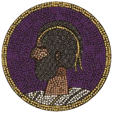
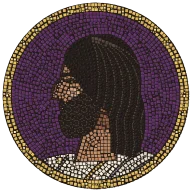
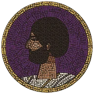
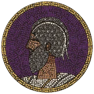
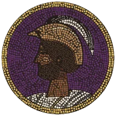

# The Carthage cast: Carthage's home politics, 410 to 380 BC (draft)

Research draft only. Nothing here changes game code or data. It is written for the war focus (Q3, Carthage's pendulum, in `docs/council/2026-11-27-war-and-geopolitics.md`) and builds on the research card `docs/research/carthage-government.md`, which sets out what the texts say about Carthage's government and where they are later than our years. The data version is `docs/drafts/carthage-cast.json`.

**What is already written elsewhere.** Himilcon, Magon and Magon's son have entries in `docs/drafts/rising-cast.md` (their wars in Sicily). Here they get their side at home. Dionysius I's campaign brief in `docs/drafts/campaign-briefs.md` lists Carthage's key men for the player; this file does not repeat it. Carthage's towns in Sicily (Motya, Panormus, Solus, Eryx and the rest) and their leading men belong to the town casts (`docs/drafts/town-casts.md`, being written alongside this one), not here.

**How to read an entry.** Name, REAL or INVENTED, faction at home, and what they want. The faction is one of the game's four Carthage blocs in `data/carthage.json` (the Elders, the Hundred, the people, the Libyans), and it is always a game proposal: no text puts any Carthaginian of these years in a bloc. "Wants" is one of Carthage's five goals in the game (Rebuild, Guard the tribute, War on the tyrant, Peace at a price, Quiet Libya), plus the seat they would want at home. **Did** is what the sources say, with the passage. **Wanted** gives a motive only where a source gives one. **Rises** and **Own move** are my game proposals (invention), for you to keep or cut. **End** is history. For invented people, **History to lean on** takes the place of Did.

**Names.** The four men already on Carthage's council in the game keep the names from their portraits (PR 95): Himilcon, Magon, Hanno the elder and Bomilcar. Invented people take names from `data/names.json`; each name is attested, but the person is not the real man or woman who bore it, and most of those are much later. Reserved names (Mago, Himilco, Hanno, Bomilcar and others, `data/census.json`) are kept off new invented people. Carthaginian names run short, so some fathers' names repeat between families.

**Sources.** Every quote was checked on 2026-11-27 against the saved texts in the Phoenician-Punic World repo (read-only): Diodorus 13 to 15 (Loeb, Oldfather), Justin 19 to 20 (Watson), Aristotle *Politics* 2.11 (Rackham). Justin and Aristotle are later than our years; each line that leans on them says so.

**Dates** are Diodorus' archon years, which straddle two of our years, so every "about" can be a year either way.

**Not in the engine yet** (checked 2026-11-27, read only). Built, always: the three voting blocs choose Carthage's goal, and the council decides when the Elders agree, otherwise the people's assembly; a lost army costs each bloc that wanted war a point of power and gives the others one; the best free man takes the command; a general who loses his army comes home in disgrace and never commands again, and Himilcon then starves himself. Built under the war switch: holding much of the island makes every bloc go to war sooner and the council hire more (the pendulum); each general is kind or harsh to towns; and a general's record (towns taken, battles won and lost) is counted but read only by the war's chapter. Not built: any Carthaginian beyond the four; which bloc backs which general; a general's standing at home; any hearing or judgement when he returns; suffetes; the people's speakers; the Libyan leaders. Entries that lean on these say "needs the standing" or "needs a speaker".

## At a glance

| Person | | Faction at home | Wants | How it ended |
|---|---|---|---|---|
| Hannibal son of Gisco | REAL | the Elders | War on the tyrant; the command | died of plague before Acragas, 406 |
| Himilcon | REAL | the Elders | War on the tyrant; the command | starved himself, 396 |
| Himilcon's sons | REAL (no names) | the Elders | Rebuild; their father's name | not known |
| Magon | REAL | the Elders | Guard the tribute; the command | killed at Cabala, about 383 |
| Magon's son | REAL (no name) | the Elders | War on the tyrant; the command | not known |
| Suniatus | REAL (one late source) | the Elders | Peace at a price; first man of the council | found guilty of treason (date disputed) |
| Hanno the general | REAL (one late source) | the Elders | War on the tyrant; the command | not known |
| The leader of the Libyan rising | REAL (no name) | the Libyans | to be left alone | the rising broke up, 396 |
| Hanno the elder | INVENTED (in the game) | the Elders | Rebuild; none, his house | |
| Carthalo son of Hamilcar | INVENTED | the Elders | Rebuild; none, his ships | |
| Sibbolet daughter of Hamilcar | INVENTED | the Elders | Rebuild; none, the warehouse | |
| Maharbal son of Carthalo | INVENTED | the Elders | War on the tyrant; the hiring, then a command | |
| Adherbal son of Sapho | INVENTED | the Elders | Quiet Libya; none, his estates | |
| Bostar son of Malchus | INVENTED | the Elders | Guard the tribute; the suffete's year | |
| Hasdrubal son of Bostar | INVENTED | the Elders | Peace at a price; the new priesthood | |
| Bomilcar | INVENTED (in the game) | the Hundred | War on the tyrant; the next command | |
| Synalus son of Adherbal | INVENTED | the Hundred | Guard the tribute; a judge's seat | |
| Annobal son of Malchus | INVENTED | the people | Rebuild; speaker of the craftsmen | |
| Bodostor son of Bodashtart | INVENTED | the people | War on the tyrant; speaker of the dockyards | |
| Zarzas son of Muttines | INVENTED | the Libyans | to be left alone; none, his town | |

Eight real, twelve invented. Of the real eight, five have a name and three do not; two of the named are known only from Justin, writing centuries later.

## The great family and the generals

  

Portraits from PR 95 (`docs/drafts/portraits/notes.md`): Himilcon, Magon, Magon's son. Their looks are invention.

### Hannibal son of Gisco · REAL
The Elders · wants **War on the tyrant**; seat: **the command**
- **Did:** "their foremost citizen" in 410/409, he advised taking Segesta, and was chosen general, "who at the time lawfully exercised sovereign powers" (13.43.5). He was "the grandson of Hamilcar" who died at Himera and "the son of Gescon, who had been exiled because of his father's defeat" (13.43.5). He hired in Iberia, "enrolled not a few from among the citizens" and chose men in Libya (13.44.6). At Himera he put some three thousand captives to death at "the spot where once his grandfather Hamilcar had been slain by Gelon" (13.62.4). At home "the whole city came out to meet him" (13.62.6). In 406 he "begged to be excused because of his age", and Himilcon was named beside him (13.80.1).
- **Wanted:** he "desired to wipe out the disgraces which had befallen his ancestors" (13.43.6).
- **Rises:** each Greek town taken in the west; each homecoming with booty.
- **Own move:** asks the council for a second general from his own family, as in 406.
- **End:** "Among the dead was also Hannibal the general", of the plague before Acragas, 406 (13.86.3). Dead before Dionysius' campaign opens in 405; here for an earlier start and to explain the family.

### Himilcon · REAL
The Elders · wants **War on the tyrant**; seat: **the command**
- **Did (at home):** "the son of Hanno and of the same family" as Hannibal, named general beside him in 406 (13.80.1). Before Acragas he made the army's offering "by sacrificing a young boy to Cronus" (13.86.3). In 397/396 Carthage made him king for the war, "lawfully according Himilcon sovereign power" (14.54.5). In 396 he paid "three hundred talents" and took only "the citizens of Carthage" home by night (14.75.1, 14.75.4). He "slipped away in disgrace to Carthage with a few survivors" (14.76.3). Justin: "the bereaved general came out of his ship, with his belt removed, and in a mean dress like that of a slave" (19.3.1, late). His wars in Sicily are in `rising-cast.md`.
- **Wanted:** not stated for him. Carthage in 406 was "eager to become lords of the whole island" (13.80.1).
- **Rises:** each town taken (his record is already counted).
- **Own move:** takes the blame in public before anyone can judge him. Walks the city in mourning, as in Justin (19.3), and his bloc loses less.
- **End:** "In the end he passed sentence of death upon himself and starved himself to death" (14.76.4). Justin: he shut his door, "admitting no one, not even his sons", and ended his life (19.3.11). No trial in either. Already in the game.

### Himilcon's sons · REAL (no names; one line in Justin)
The Elders · wants **Rebuild**; seat: **none: their father's name back**
- **Did:** Justin says only that the dying Himilco would see "no one, not even his sons" (19.3.11, late). No names, no number, no ages. Diodorus does not mention them.
- **Wanted:** not stated.
- **Rises:** each year without a new disgrace to the family; needs the standing.
- **Own move:** asks for the next command to win back the family's name, as Hannibal did for his (13.43.6).
- **End:** not in these texts.

### Magon · REAL
The Elders · wants **Guard the tribute**; seat: **the command**
- **Did (at home):** Himilcon's admiral in 396 (14.59.1). After the disaster he "set about retrieving the Carthaginian cause" and "showed kindness to the subject cities and received the victims of Dionysius' wars" (14.90.2 to 14.90.3). In 392 Carthage, "Having decided upon war", sent "no less than eighty thousand" under him (14.95.1); stuck near Agyrium and "ever more and more in want of supplies" (14.96.1), he saw the Carthaginians send "embassies to discuss peace" (14.96.3), and "After the conclusion of the treaty Magon sailed off" (14.96.4). In 383/382 "As general they chose their king Magon" (15.15.2).
- **Wanted:** "retrieving the Carthaginian cause" (14.90.2).
- **Rises:** the only man of our years who goes from admiral under a disgraced king to king himself. In the game: each town that comes over, each exile he takes in.
- **Own move:** asks for peace when supplies run short and brings the army home whole (392).
- **End:** "There fell also Magon their king after a splendid combat" (15.15.3), at Cabala, about 383 (the date is disputed; see the card). Carthage "gave their king Magon a magnificent funeral" (15.16.2).

### Magon's son · REAL (no name in Diodorus)
The Elders · wants **War on the tyrant**; seat: **the command**
- **Did:** named general in his father's place, "though he was young indeed, was full of ambition and distinguished for his courage" (15.16.2). He took the command during a truce the Carthaginians had asked for "in order that they might discuss the question with their government", after saying "it was not in their power to hand over the cities" (15.16.1). He drilled the army through the truce (15.16.2), won at Cronium, and the peace gave Carthage Selinus and Acragas' land to the Halycus, while "Dionysius paid the Carthaginians one thousand talents" (15.17.5).
- **Wanted:** not stated.
- **Rises:** from nothing to command in one truce, because his father died.
- **Own move:** after a win, offers peace at once ("bearing their victory as men should", 15.17.5).
- **End:** not in these texts.

### Suniatus · REAL (one late source; date disputed)
The Elders · wants **Peace at a price**; seat: **first man of the council**
- **Did:** Justin only (late). The leader of a new Carthaginian expedition was "Hanno the Carthaginian, ... whose enemy Suniatus, the most powerful of the Carthaginians at that time", wrote to Dionysius "in a letter written in Greek, of the approach of the army and the inactivity of its leader", and "was found, through the letter being intercepted, guilty of treason" (20.5.11 to 20.5.12). The senate then forbade Carthaginians to learn Greek (20.5.13).
- **Wanted:** to ruin Hanno, "from hatred to him" (20.5.12).
- **Rises:** each season a general of a rival house fails.
- **Own move:** a secret letter to the ruler of Syracuse that names the general's weakness. In the game it could reach you as a gift of news, and be caught.
- **End:** found guilty of treason; his punishment is not given. When: in Justin's order about 387 to 383; Wikipedia dates the ban to 368 (see the card). He may come after our years.

### Hanno the general · REAL (one late source)
The Elders · wants **War on the tyrant**; seat: **the command**
- **Did:** "The leader in the expedition was Hanno the Carthaginian" (Justin 20.5.11, late). His enemy's letter called him inactive (20.5.12). Nothing else. Diodorus names Magon as general of the war of 383/382 (15.15.2), so Justin's Hanno belongs to that war under another name, to a later war (the 360s), or to Justin's error. Not the game's Hanno the elder.
- **Wanted:** not stated.
- **Rises:** each rival at home who falls; needs the standing.
- **Own move:** watches the letters that go to Syracuse.
- **End:** not in these texts.

### The leader of the Libyan rising · REAL (no name in the texts)
The Libyans · wants **to be left alone**; seat: **none: Libya free**
- **Did:** in 396 Carthage's Libyan allies, "who had long hated the oppressive rule of the Carthaginians and even more at this time because of the betrayal of the soldiers at Syracuse, were inflamed against them" (14.77.1). Joined "not only by freemen but also by slaves", they raised "a body of two hundred thousand men" and seized Tunis (14.77.3). But they "possessed no capable commanders", and "they quarrelled among themselves over the supreme command and some of them were bought off with Carthaginian money" (14.77.6). One leader or several, Diodorus does not say. The number is his; read it as a very large rising.
- **Wanted:** the betrayal at Syracuse is the reason given (14.77.1).
- **Rises:** each levy; each army Carthage abandons, as Himilcon did his.
- **Own move:** takes Tunis and shuts Carthage in its walls, as in 14.77.3.
- **End:** the rising "broke up and scattered to their native lands" (14.77.6).

## The Elders' houses



### Hanno the elder · INVENTED (in the game)
The Elders · wants **Rebuild**; seat: **none: the head of a merchant house**
- **Why invented:** in the game already (`data/carthage.json`), portrait in PR 95. No text names an Elder of our years other than the generals.
- **History to lean on:** Dionysius' letter was read "in the council and subsequently before the people" (14.47.2), so the Elders hear first. Aristotle, later: rulers are chosen "not only for their merit but also for their wealth" (*Politics* 2.11, 1273a).
- **Rises:** each season of peace in which trade pays.
- **Own move:** pays for an embassy of peace, as in 392 (14.96.3).
- **End:** none written.

### Carthalo son of Hamilcar · INVENTED
The Elders · wants **Rebuild**; seat: **none: his ships**
- **Why invented:** no Carthaginian merchant of our years is named.
- **History to lean on:** at Syracuse in 398/397 "no small number of Carthaginians had their homes in Syracuse and rich possessions, and many also of their merchants had vessels in the harbour loaded with goods", and the Syracusans plundered them "with the permission of Dionysius" (14.46.1). Carthalo is a later name (a commander of the 240s, Polybius 1.53).
- **Wanted (invention):** his goods back and the harbour of Syracuse open.
- **Rises:** each peace that reopens trade.
- **Own move:** offers his ships to carry the hired men, at a price; holds them back if the price is not met.
- **End:** none written. Grudge (invention): the plunder of 398/397.

### Sibbolet daughter of Hamilcar · INVENTED
The Elders · wants **Rebuild**; seat: **none: she runs her brother Carthalo's warehouse**
- **Why invented:** the saved texts name almost no Carthaginian women. Sibbolet is the name of "a businesswoman of the City" on an undated gravestone at Carthage (`docs/research/punic-womens-names.md`).
- **History to lean on:** Greeks lived at Carthage; after 396 Carthage chose "the most prominent Greeks who lived among them" for the new rites (14.77.5).
- **Wanted (invention):** trade with Greeks, whatever the war.
- **Rises:** each peace.
- **Own move:** sends word to Syracuse through Greek traders, and so is in danger once Greek is banned (Justin 20.5.13, late).
- **End:** none written.

### Maharbal son of Carthalo · INVENTED
The Elders · wants **War on the tyrant**; seat: **the hiring, then a command**
- **Why invented:** the men who carried Carthage's silver abroad are never named.
- **History to lean on:** in 406 Carthage sent "certain citizens who were held in high esteem among the Carthaginians with large sums of money, some to Iberia and others to the Baliarides Islands" (13.80.2); in 398/397 it "dispatched members of the senate with large sums of money to recruit mercenaries in Europe" (14.47.3). In 409 the Campanians complained that their rewards "were not a fair return" (13.62.5). Maharbal is a later name (Livy 23.18.4, 216).
- **Wanted (invention):** the captains in his debt.
- **Rises:** each army he raises; each captain who owes him.
- **Own move:** starts hiring before the council has voted for war, so the vote follows the army.
- **End:** none written.

### Adherbal son of Sapho · INVENTED
The Elders · wants **Quiet Libya**; seat: **none: his estates in Libya**
- **Why invented:** no landowner is named.
- **History to lean on:** in 405 the plague raged "in Libya also" (13.114.2); in 396 the Libyans rose against "the oppressive rule of the Carthaginians" and slaves joined them (14.77.1, 14.77.3). Adherbal is a later name (an admiral of the 240s, Polybius 1.44).
- **Wanted (invention):** no more levies from his land, and his slaves back.
- **Rises:** each season Libya is quiet.
- **Own move:** buys off a rebel leader with his own silver, as Carthage did in 396 (14.77.6).
- **End:** none written.

### Bostar son of Malchus · INVENTED (a suffete)
The Elders · wants **Guard the tribute**; seat: **the suffete's year**
- **Why invented:** no text names a suffete of our years, and whether two yearly suffetes held office in 405 is disputed (the card, section 1).
- **History to lean on:** Aristotle, later: matters go to the people unless "the kings in consultation with the Elders" agree (1273a), and the kings "are not confined to the same family" (1272b). Bostar is a later name (an envoy of 215, Livy 23.34.2).
- **Wanted (invention):** a quiet year with his name on it.
- **Rises:** chosen for a year; needs the suffetes.
- **Own move:** sends a split question to the people's assembly (the rule the game already uses), when he expects the people to side with him.
- **End:** none written.

### Hasdrubal son of Bostar · INVENTED (a priest of Demeter and Kore)
The Elders · wants **Peace at a price**; seat: **the new priesthood**
- **Why invented:** the first priests are not named.
- **History to lean on:** in 396 Carthage "voted by every means to propitiate the gods" and "appointed their most renowned citizens to be priests of these goddesses" (14.77.4 to 14.77.5). The game already has Carthage propitiate the gods when they "seem to be against" it.
- **Wanted (invention):** the goddesses honoured before any new war.
- **Rises:** each plague, each lost army.
- **Own move:** declares the gods against the war, and the people's mood follows.
- **End:** none written. He works beside Greeks (14.77.5); a ban on Greek would cut against him.

## The Hundred



### Bomilcar · INVENTED (in the game)
The Hundred · wants **War on the tyrant**; seat: **the next command**
- **Why invented:** in the game already ("A man of the Hundred who wants a command"), portrait in PR 95. Not the real Bomilcar who tried to seize Carthage in 308, who is later than our years.
- **History to lean on:** a general was chosen for each war (13.43.5, 13.80.1, 14.54.5, 15.15.2). Aristotle, later: "the greatest offices of state, the kingship and the generalship, should be for sale" (1273a).
- **Rises:** each general who falls.
- **Own move:** buys the votes for the next command.
- **End:** none written.

### Synalus son of Adherbal · INVENTED (a judge of the Hundred and Four)
The Hundred · wants **Guard the tribute**; seat: **a judge's seat**
- **Why invented:** no judge is named, and no court sits in any text of our years.
- **History to lean on:** Justin, late: "a hundred judges were chosen out of the senate, ... who were to demand of the generals, when they returned from war, an account of their proceedings" (19.2.5 to 19.2.6). Aristotle, later: "the Carthaginians elect this magistracy by merit" (1272b). Synalus is a later name (the commander at Minoa, 357, Plutarch *Dion* 25).
- **Wanted (invention):** generals who answer to the city.
- **Rises:** each general who comes home beaten.
- **Own move:** calls a returning general to account, the hearing Himilcon never faced. Needs the standing.
- **End:** none written. His father Adherbal sits with the Elders, so one family has a voice in two bodies.

## The people

### Annobal son of Malchus · INVENTED
The people · wants **Rebuild**; seat: **speaker of the craftsmen**
- **Why invented:** no speaker of Carthage's people is named before Hannibal's time.
- **History to lean on:** in 398/397 the letter was read to the council "and subsequently before the people" (14.47.2); after 396 "the entire city was seized by superstitious fear and dread" (14.77.4). Aristotle, later: "anybody who wishes may speak against the proposals introduced" (1273a). Annobal is a name from an inscription of AD 1 to 2, far later.
- **Wanted (invention):** bread, and the plague over.
- **Rises:** each time the Elders split and a matter goes to the people. Needs a speaker.
- **Own move:** speaks against his brother Bostar's proposal in the assembly.
- **End:** none written. Brother of the suffete Bostar: one house on two sides.

### Bodostor son of Bodashtart · INVENTED
The people · wants **War on the tyrant**; seat: **speaker of the dockyards**
- **Why invented:** as for Annobal.
- **History to lean on:** Ephorus' figures for 396 give "four hundred ships of war" (14.54.5); that fleet was burned before Syracuse (14.76.2). Bodostor is a later name (Diodorus 24.12.1, the 250s); Bodashtart is a name from the Phoenician homeland.
- **Wanted (invention):** ships on the slips and wages paid.
- **Rises:** each fleet the council votes.
- **Own move:** brings the dockyards to the assembly when a peace would cut the fleet.
- **End:** none written.

## The Libyans

### Zarzas son of Muttines · INVENTED
The Libyans · wants **to be left alone**; seat: **none: first man of his town**
- **Why invented:** no Libyan of our years is named.
- **History to lean on:** Libyans served in every army ("five thousand Libyans", 13.44.1); in 396 "some of them were bought off with Carthaginian money and deserted the common cause" (14.77.6). Zarzas and Muttines are names of Libyans who served Carthage, both much later (Polybius 1.84; Livy 25.40.5).
- **Wanted (invention):** his town spared the levy.
- **Rises:** each levy Carthage forgives his town.
- **Own move:** takes Carthage's silver and leaves the rising.
- **End:** none written.

## Three ways home politics could steer Carthage's war (kind: invention)

Input for the war focus, not a build. Each is honest about what is built. Today the blocs already choose war or peace by thresholds, the pendulum makes them choose war sooner, a lost army moves a point of power from the war party to the others, and a beaten general comes home disgraced for good.

### A. Faces on the vote (cheap)
- **Who wants war, who wants trade.** Each bloc's vote is shown with a named speaker from this cast and his one-line reason: Hanno the elder for trade ("the tribute must be kept"), Bomilcar for war, Annobal or Bodostor for the people. The vote is unchanged.
- **Who leads.** The general for a war comes from the bloc that carried it: an Elder's man if the council decided, the people's favourite if the assembly did. Today the engine picks the best free general.
- **What brings a general down.** As now, losing his army. His homecoming takes one of the three ends the sources give: a welcome (13.62.6), self-judgement (14.76.4), or a funeral (15.16.2).
- **Cost:** about twenty records and some lines of text. No new rules.

### B. A general's standing at home (medium, the unbuilt part of 3B)
A plus:
- **Each general has a backer and a standing.** His backer is one bloc; his standing rises with his record (already counted) and falls with plague, abandoned allies and Libyan anger.
- **The return is a matter.** When a war ends or an army is lost, the general comes home to a hearing before the Hundred (Synalus). The outcome follows his standing. A welcome lifts his bloc. Disgrace sinks it, and the next command goes to a rival bloc's man, who brings a different method (Himilcon's force, Magon's kindness). Self-judgement, as Himilcon chose, is the one way to save his family's standing.
- **The war party splits.** The Elders are two houses, the great family (war for honour) and the traders (Rebuild); which leads decides the Elders' vote.
- **You can reach in.** A letter from Suniatus can reach you, naming the general's weakness, and can be caught. Plundering Carthaginian merchants (as in 398/397) angers the traders.
- **History warning:** no general of 410 to 380 is recorded as tried. The hearing is built from Justin (centuries later) and Aristotle (60 years later), so it should be a switch, with the plain note that it is later practice.
- **Cost:** a standing number per general, one new matter, and the hearing's three outcomes.

### C. Carthage's own rival moves (costly)
B plus:
- **Every named Carthaginian makes one move a year**, as the rising cast's rivals would. Suniatus writes letters, Bomilcar buys the command, Maharbal hires before the vote, Annobal takes questions to the people, Hasdrubal calls for the gods, Adherbal buys off Libyans, Zarzas takes silver or rises.
- **The suffete's year turns.** The suffete chooses which questions reach the assembly. The ban on Greek can pass and cut your letters and spies into Carthage.
- **Libya answers Carthage's choices.** Abandoning an army, as Himilcon did, sets off a rising (14.77.1).
- **Cost:** a second rival engine for Carthage, more records, and a need to count that its wars still come and end.

## Where the sources disagree or are thin

1. **Himilcon's father.** Diodorus: "the son of Hanno and of the same family" as Hannibal (13.80.1). Justin: a son of the Hamilcar of 480 (19.2.1, 19.2.7), a generation earlier. Justin's Hanno, son of Hamilcar, could be Diodorus' Hanno, Himilcon's father; that is my inference, not a text.
2. **How Himilcon died.** Diodorus: starved himself (14.76.4). Justin: ended his life behind a locked door, means not given (19.3.11).
3. **Suniatus and Hanno.** Known only from Justin. In his order about 387 to 383, but Wikipedia dates the ban on Greek to 368, and Diodorus names Magon as the general of 383/382. They may belong after our years.
4. **"King."** Diodorus' Greek makes Hannibal (410/409) and Himilcon (397/396) king "according to the law", and calls Magon "their king" (383/382). What that meant is open; the card sets out five modern readings.
5. **The date of Cabala and Cronium.** Diodorus files them under 383/382; many modern accounts put them later. If so, Magon dies and his son wins after 380.
6. **Thin entries.** Himilcon's sons are half a line in Justin. Hanno the general is one sentence. Magon's son and the Libyan leader have no names.
7. **Faction.** No text puts any of these men in a bloc. Putting all the generals with the Elders follows Justin's and Hoyos' picture of one great family; it is a game proposal.

## Considered and left out

- **Gescon (Gisco), Hannibal's father**, exiled after Himera and dead at Selinus (13.43.5): dead long before our years. Remembered in Hannibal's entry.
- **Hanno, Himilcon's father** (13.80.1): a name only. His name is the dead father's, as `data/census.json` allows.
- **Malchus** (Justin 18.7), **the Bomilcar of 308**, **Hanno the Great** and **the Mago of about 343** (Plutarch, *Timoleon* 22): far earlier or later.
- **The Carthaginian envoys** of 406 to Athens (Hoyos p. 41, not opened) and of 392 and 383 (14.96.3, 15.15.4): unnamed, and folded into Hanno the elder's move.
- **The hired captains** (Libyan, Iberian, Campanian): already generated by `data/census.json`.
- **Carthage's towns in Sicily** and their first men: the town casts.

## My view (Claude's, not the sources')

The best home arcs are Himilcon's fall (king in 396, in rags the same year), Magon's rise (admiral under a disgraced king to king), and Suniatus' letter, if you accept Justin's date. Option B is the smallest change that makes "what brings a general down" a choice rather than a roll, but its hearing is later practice, so I would ship it behind a switch with that said on screen.

## Quote check

kind: history. Every quote above, with the file it was checked against on 2026-11-27 (paths under `sources/` in the Phoenician-Punic World repo). The goal names (Rebuild, Guard the tribute and the rest), the line "the tribute must be kept", "seem to be against" and "A man of the Hundred who wants a command" are the game's own words in `data/carthage.json` and `src/core/carthage.ts`, and are not listed. Sibbolet's "a businesswoman of the City" is quoted from `docs/research/punic-womens-names.md` in this repo.

```
diodorus/english/book13.loeb.txt | their foremost citizen
diodorus/english/book13.loeb.txt | who at the time lawfully exercised sovereign powers
diodorus/english/book13.loeb.txt | the grandson of Hamilcar
diodorus/english/book13.loeb.txt | the son of Gescon, who had been exiled because of his father's defeat
diodorus/english/book13.loeb.txt | enrolled not a few from among the citizens
diodorus/english/book13.loeb.txt | the spot where once his grandfather Hamilcar had been slain by Gelon
diodorus/english/book13.loeb.txt | the whole city came out to meet him
diodorus/english/book13.loeb.txt | begged to be excused because of his age
diodorus/english/book13.loeb.txt | desired to wipe out the disgraces which had befallen his ancestors
diodorus/english/book13.loeb.txt | Among the dead was also Hannibal the general
diodorus/english/book13.loeb.txt | the son of Hanno and of the same family
diodorus/english/book13.loeb.txt | by sacrificing a young boy to Cronus
diodorus/english/book14.loeb.txt | lawfully according Himilcon sovereign power
diodorus/english/book14.loeb.txt | three hundred talents
diodorus/english/book14.loeb.txt | the citizens of Carthage
diodorus/english/book14.loeb.txt | slipped away in disgrace to Carthage with a few survivors
justin/justin-18.7-19.1.watson.txt | the bereaved general came out of his ship, with his belt removed, and in a mean dress like that of a slave
diodorus/english/book13.loeb.txt | eager to become lords of the whole island
diodorus/english/book14.loeb.txt | In the end he passed sentence of death upon himself and starved himself to death
justin/justin-18.7-19.1.watson.txt | admitting no one, not even his sons
justin/justin-18.7-19.1.watson.txt | no one, not even his sons
diodorus/english/book14-78-96.txt | set about retrieving the Carthaginian cause
diodorus/english/book14-78-96.txt | showed kindness to the subject cities and received the victims of Dionysius' wars
diodorus/english/book14-78-96.txt | Having decided upon war
diodorus/english/book14-78-96.txt | no less than eighty thousand
diodorus/english/book14-78-96.txt | ever more and more in want of supplies
diodorus/english/book14-78-96.txt | embassies to discuss peace
diodorus/english/book14-78-96.txt | After the conclusion of the treaty Magon sailed off
diodorus/english/book15.loeb.txt | As general they chose their king Magon
diodorus/english/book14-78-96.txt | retrieving the Carthaginian cause
diodorus/english/book15.loeb.txt | There fell also Magon their king after a splendid combat
diodorus/english/book15.loeb.txt | gave their king Magon a magnificent funeral
diodorus/english/book15.loeb.txt | though he was young indeed, was full of ambition and distinguished for his courage
diodorus/english/book15.loeb.txt | in order that they might discuss the question with their government
diodorus/english/book15.loeb.txt | it was not in their power to hand over the cities
diodorus/english/book15.loeb.txt | Dionysius paid the Carthaginians one thousand talents
diodorus/english/book15.loeb.txt | bearing their victory as men should
justin/justin-18.7-19.1.watson.txt | Hanno the Carthaginian, ... whose enemy Suniatus, the most powerful of the Carthaginians at that time
justin/justin-18.7-19.1.watson.txt | in a letter written in Greek, of the approach of the army and the inactivity of its leader
justin/justin-18.7-19.1.watson.txt | was found, through the letter being intercepted, guilty of treason
justin/justin-18.7-19.1.watson.txt | from hatred to him
justin/justin-18.7-19.1.watson.txt | The leader in the expedition was Hanno the Carthaginian
religion/diodorus-14.77-loeb.txt | who had long hated the oppressive rule of the Carthaginians and even more at this time because of the betrayal of the soldiers at Syracuse, were inflamed against them
religion/diodorus-14.77-loeb.txt | not only by freemen but also by slaves
religion/diodorus-14.77-loeb.txt | a body of two hundred thousand men
religion/diodorus-14.77-loeb.txt | possessed no capable commanders
religion/diodorus-14.77-loeb.txt | they quarrelled among themselves over the supreme command and some of them were bought off with Carthaginian money
religion/diodorus-14.77-loeb.txt | broke up and scattered to their native lands
diodorus/english/book14.loeb.txt | in the council and subsequently before the people
governance/aristotle-politics-2.11.txt | not only for their merit but also for their wealth
diodorus/english/book14.loeb.txt | no small number of Carthaginians had their homes in Syracuse and rich possessions, and many also of their merchants had vessels in the harbour loaded with goods
diodorus/english/book14.loeb.txt | with the permission of Dionysius
religion/diodorus-14.77-loeb.txt | the most prominent Greeks who lived among them
diodorus/english/book13.loeb.txt | certain citizens who were held in high esteem among the Carthaginians with large sums of money, some to Iberia and others to the Baliarides Islands
diodorus/english/book14.loeb.txt | dispatched members of the senate with large sums of money to recruit mercenaries in Europe
diodorus/english/book13.loeb.txt | were not a fair return
diodorus/english/book13.loeb.txt | in Libya also
religion/diodorus-14.77-loeb.txt | the oppressive rule of the Carthaginians
governance/aristotle-politics-2.11.txt | the kings in consultation with the Elders
governance/aristotle-politics-2.11.txt | are not confined to the same family
religion/diodorus-14.77-loeb.txt | voted by every means to propitiate the gods
religion/diodorus-14.77-loeb.txt | appointed their most renowned citizens to be priests of these goddesses
governance/aristotle-politics-2.11.txt | the greatest offices of state, the kingship and the generalship, should be for sale
justin/justin-18.7-19.1.watson.txt | a hundred judges were chosen out of the senate, ... who were to demand of the generals, when they returned from war, an account of their proceedings
governance/aristotle-politics-2.11.txt | the Carthaginians elect this magistracy by merit
religion/diodorus-14.77-loeb.txt | the entire city was seized by superstitious fear and dread
governance/aristotle-politics-2.11.txt | anybody who wishes may speak against the proposals introduced
diodorus/english/book14.loeb.txt | four hundred ships of war
diodorus/english/book13.loeb.txt | five thousand Libyans
religion/diodorus-14.77-loeb.txt | some of them were bought off with Carthaginian money and deserted the common cause
diodorus/english/book15.loeb.txt | their king
diodorus/english/book14.loeb.txt | according Himilcon sovereign power
```
