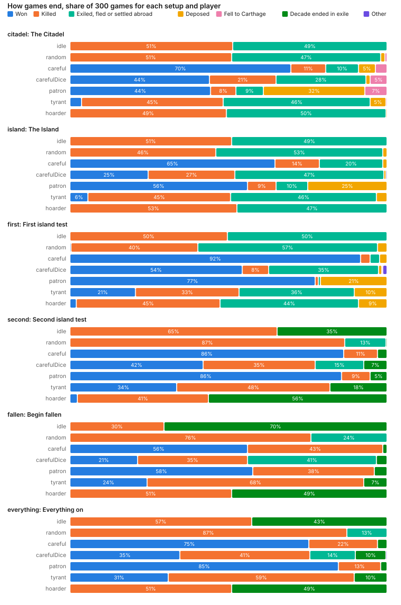
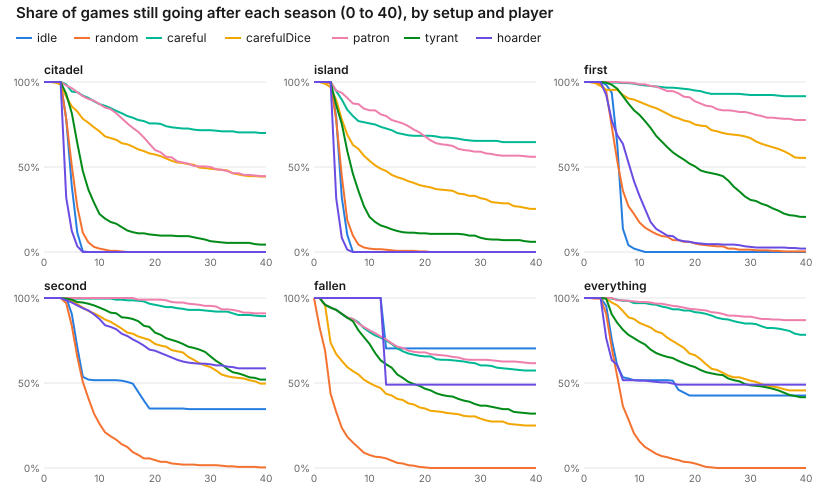

# Playtest bot: the numbers

Written by `npm run playtest` (scripts/playtest.ts). 12600 games by 7 kinds of player (seeds 1 to 300 for each setup and player), and 10920 games in the one-action sweep (seeds 1 to 40 for each action). The plain-words summary and the fix ideas are in `report.md` beside this file. Any game here replays with `npm run playtest -- --one <setup>:<player>:<seed>`.

## The setups

- **citadel**: The Citadel (Phase 1: Syracuse alone, Carthage as a clock).
- **island**: The Island (Phase 2, no rule switches).
- **first**: First island test (preset).
- **second**: Second island test (preset, the recommended game).
- **fallen**: Begin fallen (Workshop: the island game opening in exile).
- **everything**: Everything on (stress test: the island game with every rule switch but Begin fallen).

## The players

- **idle** (Idle): Does nothing at all: no actions, matters take their default, petitions lapse. Shows what the game does on its own.
- **random** (Random): Every move at random: random legal actions with random targets, random answers to matters, refuses about one petition in three.
- **careful** (Always safe (the careful ruler)): The existing careful bot: pays the guard, watches grudges, pardons, arrests only names it knows, answers matters by their listed effects.
- **carefulDice** (Always safe, random answers): The careful ruler's actions, but every matter answered at random: shows which answers help or hurt.
- **patron** (The patron): The existing patron bot: grants petitions and offices, feasts, buys off grudges.
- **tyrant** (Aggressive (the iron hand)): The existing iron-hand bot: mercenaries, the citadel, every office, arrests and executions, seizes the rich, sacks towns.
- **hoarder** (Greedy (the hoarder)): Only takes silver: strikes coin, passes the levies, seizes, raids; refuses every petition; answers matters for the most silver.
- **only:<action>** (the sweep): takes that one action whenever any target makes it legal and does nothing else; matters take their default.

## Problems found

Checked in every game: crashes; the game's own broken-state check after every season (not only at the end); a season that cannot end or a game that never ends; more than 20 actions in one season (an action that costs nothing); replaying the recorded inputs must give the same game; the state must stay plain data (no NaN, no class objects).

| setup | player | broken state |
|---|---|---|
| fallen | carefulDice | 1 |
| everything | idle | 38 |
| everything | random | 4 |
| everything | careful | 2 |
| everything | carefulDice | 23 |
| everything | patron | 16 |
| everything | tyrant | 27 |
| everything | hoarder | 45 |
| everything | only:feast | 2 |
| everything | only:grantOffice | 3 |
| everything | only:revokeOffice | 2 |
| everything | only:marriage | 5 |
| everything | only:petition | 6 |
| everything | only:bribe | 4 |
| everything | only:pardon | 3 |
| everything | only:imprison | 1 |
| everything | only:execute | 6 |
| everything | only:exile | 6 |
| everything | only:grainHandout | 5 |
| everything | only:giveLand | 3 |
| everything | only:proposeLaw | 4 |
| everything | only:seize | 7 |
| everything | only:strikeCoin | 7 |
| everything | only:build | 7 |
| everything | only:payGuard | 5 |
| everything | only:hire | 5 |
| everything | only:disarm | 4 |
| everything | only:watch | 4 |
| everything | only:plantRumor | 9 |
| everything | only:turnInformer | 8 |
| everything | only:forceFavor | 6 |
| everything | only:block | 6 |
| everything | only:expose | 6 |
| everything | only:envoy | 4 |
| everything | only:buyGrain | 6 |
| everything | only:offerTerms | 6 |
| everything | only:muster | 2 |
| everything | only:sendArmy | 6 |
| everything | only:assault | 6 |
| everything | only:forage | 6 |
| everything | only:disband | 6 |
| everything | only:embassyCity | 8 |
| everything | only:declareWar | 7 |
| everything | only:acceptPeace | 6 |
| everything | only:askHolder | 5 |
| everything | only:backCandidate | 7 |
| everything | only:appointCaptain | 6 |
| everything | only:giveCommand | 6 |
| everything | only:seatCounsel | 2 |
| everything | only:payServants | 7 |
| everything | only:buySilence | 6 |
| everything | only:swearQuarrel | 7 |
| everything | only:accuseAssembly | 6 |
| everything | only:demandOffice | 6 |
| everything | only:sendGrain | 6 |
| everything | only:auditContracts | 6 |
| everything | only:hostDinner | 2 |
| everything | only:spyTown | 6 |
| everything | only:beginWork | 2 |
| everything | only:overseeWork | 6 |
| everything | only:haltWork | 6 |
| everything | only:exWrite | 8 |
| everything | only:exSlander | 7 |
| everything | only:exHire | 5 |
| everything | only:exArms | 6 |
| everything | only:exRaid | 6 |
| everything | only:exInside | 7 |
| everything | only:exPatron | 4 |
| everything | only:exLieLow | 7 |
| everything | only:exMove | 5 |
| everything | only:exStrike | 2 |

Examples (up to five of each kind in each setup), with the command that replays the game:

**broken state** in fallen:

- fallen, carefulDice, seed 97, season 34: plot member theodorus is dead `npm run playtest -- --one fallen:carefulDice:97`

**broken state** in everything:

- everything, idle, seed 1, season 12: council seat held by the dead or missing c1 `npm run playtest -- --one everything:idle:1`
- everything, idle, seed 4, season 5: council seat held by the dead or missing c1 `npm run playtest -- --one everything:idle:4`
- everything, idle, seed 12, season 20: council seat held by the dead or missing c1 `npm run playtest -- --one everything:idle:12`
- everything, idle, seed 19, season 38: council seat held by the dead or missing c1 `npm run playtest -- --one everything:idle:19`
- everything, idle, seed 21, season 15: council seat held by the dead or missing c1 `npm run playtest -- --one everything:idle:21`

Seasons that began with no action left to take: never three in a row. Seasons with actions left but nothing legal on the menu: 0.

## How games end

Won means the decade ended with you still holding Syracuse. Length is seasons played (40 is the whole decade). "Still playing" counts games not yet over at the end of season 10, 20 and 30; in the exile setups that includes playing on in exile. The chart is `outcomes.svg`.

### citadel: The Citadel (Phase 1: Syracuse alone, Carthage as a clock)

| player | games | won: held Syracuse to the end | killed | driven into exile (game over) | deposed by a rival | Syracuse fell to Carthage | fled (an event) | median length | 1 in 10 over by | still playing at 10 / 20 / 30 | ever a tyranny |
|---|---|---|---|---|---|---|---|---|---|---|---|
| idle | 300 | 0% | 51% | 49% | 0% | 0% | 0% | 5 | 4 | 0% / 0% / 0% | 0% |
| random | 300 | 0% | 51% | 45% | 1% | 1% | 2% | 6 | 4 | 2% / 0% / 0% | 2% |
| careful | 300 | 70% | 11% | 10% | 5% | 4% | 0% | 40 | 9 | 87% / 76% / 72% | 23% |
| carefulDice | 300 | 44% | 21% | 16% | 1% | 5% | 12% | 28 | 5 | 71% / 57% / 49% | 14% |
| patron | 300 | 44% | 8% | 9% | 32% | 7% | 0% | 31 | 9 | 87% / 60% / 50% | 0% |
| tyrant | 300 | 4% | 45% | 46% | 5% | 0% | 0% | 7 | 5 | 22% / 10% / 6% | 95% |
| hoarder | 300 | 0% | 49% | 50% | 0% | 0% | 0% | 4 | 4 | 0% / 0% / 0% | 0% |

Who ended the rule most often (all players together): the leader of the exiles at Aetna 578, the brother of Demarchus 447, Nicoteles 163, Hipparinus 136, Leptines 110.

### island: The Island (Phase 2, no rule switches)

| player | games | won: held Syracuse to the end | killed | driven into exile (game over) | deposed by a rival | fled (an event) | gave up power (an event) | median length | 1 in 10 over by | still playing at 10 / 20 / 30 | ever a tyranny |
|---|---|---|---|---|---|---|---|---|---|---|---|
| idle | 300 | 0% | 51% | 49% | 0% | 0% | 0% | 5 | 4 | 0% / 0% / 0% | 0% |
| random | 300 | 0% | 46% | 48% | 1% | 5% | 0% | 5 | 4 | 2% / 0% / 0% | 0% |
| careful | 300 | 65% | 14% | 20% | 1% | 0% | 0% | 40 | 5 | 76% / 68% / 65% | 23% |
| carefulDice | 300 | 25% | 27% | 24% | 1% | 23% | 0% | 12 | 4 | 54% / 39% / 32% | 9% |
| patron | 300 | 56% | 9% | 10% | 25% | 0% | 0% | 40 | 7 | 83% / 68% / 59% | 0% |
| tyrant | 300 | 6% | 45% | 46% | 3% | 0% | 0% | 7 | 4 | 21% / 11% / 8% | 94% |
| hoarder | 300 | 0% | 53% | 47% | 0% | 0% | 0% | 4 | 4 | 0% / 0% / 0% | 0% |

Who ended the rule most often (all players together): the leader of the exiles at Aetna 711, the brother of Demarchus 477, Nicoteles 122, Hipparinus 92, Leptines 77.

### first: First island test (preset)

| player | games | won: held Syracuse to the end | killed | driven into exile (game over) | deposed by a rival | Syracuse fell to Carthage | fled (an event) | gave up power (an event) | median length | 1 in 10 over by | still playing at 10 / 20 / 30 | ever a tyranny |
|---|---|---|---|---|---|---|---|---|---|---|---|---|
| idle | 300 | 0% | 50% | 50% | 0% | 0% | 0% | 0% | 7 | 6 | 1% / 0% / 0% | 0% |
| random | 300 | 0% | 40% | 51% | 3% | 0% | 6% | 0% | 7 | 5 | 17% / 5% / 1% | 1% |
| careful | 300 | 92% | 3% | 3% | 2% | 0% | 0% | 0% | 40 | 40 | 98% / 95% / 92% | 44% |
| carefulDice | 300 | 54% | 8% | 7% | 1% | 0% | 28% | 1% | 40 | 9 | 88% / 75% / 67% | 30% |
| patron | 300 | 77% | 1% | 1% | 21% | 0% | 0% | 0% | 40 | 20 | 99% / 89% / 82% | 3% |
| tyrant | 300 | 21% | 33% | 36% | 10% | 0% | 0% | 0% | 21 | 8 | 81% / 50% / 31% | 97% |
| hoarder | 300 | 2% | 45% | 44% | 9% | 0% | 0% | 0% | 9 | 5 | 33% / 5% / 3% | 0% |

Who ended the rule most often (all players together): the leader of the exiles at Aetna 458, the brother of Demarchus 377, Hipparinus 160, Nicoteles 156, Aristomache 23.

### second: Second island test (preset, the recommended game)

| player | games | won: held Syracuse to the end | killed | the decade ended with you in exile | settled abroad for good | median length | 1 in 10 over by | still playing at 10 / 20 / 30 | ever a tyranny |
|---|---|---|---|---|---|---|---|---|---|
| idle | 300 | 0% | 65% | 35% | 0% | 16 | 6 | 52% / 35% / 35% | 0% |
| random | 300 | 0% | 87% | 0% | 13% | 8 | 5 | 26% / 5% / 2% | 2% |
| careful | 300 | 86% | 11% | 3% | 0% | 40 | 38 | 100% / 96% / 92% | 11% |
| carefulDice | 300 | 42% | 35% | 7% | 15% | 39 | 10 | 89% / 73% / 59% | 6% |
| patron | 300 | 86% | 9% | 5% | 0% | 40 | 40 | 100% / 99% / 95% | 0% |
| tyrant | 300 | 34% | 48% | 18% | 0% | 40 | 14 | 94% / 80% / 66% | 94% |
| hoarder | 300 | 2% | 41% | 56% | 0% | 40 | 10 | 88% / 69% / 61% | 0% |

Who ended the rule most often (all players together): the leader of the exiles at Aetna 323, the brother of Demarchus 249, Hipparinus 152, Nicoteles 48, Leptines 24.

### fallen: Begin fallen (Workshop: the island game opening in exile)

| player | games | won: held Syracuse to the end | killed | the decade ended with you in exile | settled abroad for good | median length | 1 in 10 over by | still playing at 10 / 20 / 30 | ever a tyranny |
|---|---|---|---|---|---|---|---|---|---|
| idle | 300 | 0% | 30% | 70% | 0% | 40 | 13 | 100% / 70% / 70% | 0% |
| random | 300 | 0% | 76% | 0% | 24% | 3 | 1 | 8% / 0% / 0% | 0% |
| careful | 300 | 56% | 43% | 1% | 0% | 40 | 6 | 80% / 66% / 60% | 12% |
| carefulDice | 300 | 21% | 35% | 3% | 41% | 11 | 3 | 50% / 35% / 29% | 4% |
| patron | 300 | 58% | 38% | 4% | 0% | 40 | 6 | 81% / 68% / 64% | 0% |
| tyrant | 300 | 24% | 68% | 7% | 0% | 18 | 6 | 73% / 47% / 37% | 68% |
| hoarder | 300 | 0% | 51% | 49% | 0% | 13 | 13 | 100% / 49% / 49% | 0% |

Who ended the rule most often (all players together): the leader of the exiles at Aetna 946, the brother of Demarchus 79, Nicoteles 52, Hipparinus 31, Thearides 29.

### everything: Everything on (stress test: the island game with every rule switch but Begin fallen)

| player | games | won: held Syracuse to the end | killed | the decade ended with you in exile | settled abroad for good | gave up power (an event) | median length | 1 in 10 over by | still playing at 10 / 20 / 30 | ever a tyranny |
|---|---|---|---|---|---|---|---|---|---|---|
| idle | 300 | 0% | 57% | 43% | 0% | 0% | 17 | 5 | 52% / 43% / 43% | 0% |
| random | 300 | 0% | 87% | 0% | 13% | 0% | 7 | 5 | 16% / 3% / 0% | 1% |
| careful | 300 | 75% | 22% | 3% | 0% | 0% | 40 | 23 | 97% / 92% / 85% | 4% |
| carefulDice | 300 | 35% | 41% | 10% | 14% | 0% | 32 | 8 | 85% / 66% / 51% | 3% |
| patron | 300 | 85% | 13% | 2% | 0% | 0% | 40 | 26 | 98% / 93% / 89% | 0% |
| tyrant | 300 | 31% | 59% | 10% | 0% | 0% | 29 | 6 | 74% / 59% / 49% | 76% |
| hoarder | 300 | 0% | 51% | 49% | 0% | 0% | 16 | 4 | 51% / 49% / 49% | 0% |

Who ended the rule most often (all players together): the leader of the exiles at Aetna 460, the brother of Demarchus 302, Hipparinus 109, Leptines 64, Nicoteles 35.

Players that win nine games in ten or more: careful in first (92%).

Players that never won a game: idle in citadel, random in citadel, hoarder in citadel, idle in island, random in island, hoarder in island, idle in first, idle in second, random in second, idle in fallen, random in fallen, hoarder in fallen, idle in everything, random in everything, hoarder in everything.

## The one-action sweep

Each action played alone, 40 games each, against doing nothing at all (idle, same seeds). An action that wins or lasts far longer on its own is either very strong or a hole.

### citadel (idle wins 0%, median length 5)

| action alone | wins | median length | 1 in 10 over by | most common end |
|---|---|---|---|---|
| Pardon (`pardon`) | 0% | 7 | 6 | killed 53% |
| Disarm the citizens (`disarm`) | 0% | 6 | 5 | driven into exile (game over) 60% |
| Exile (`exile`) | 0% | 6 | 5 | driven into exile (game over) 50% |
| Give land (`giveLand`) | 0% | 6 | 5 | killed 53% |
| Hand out grain (`grainHandout`) | 0% | 6 | 5 | driven into exile (game over) 53% |
| Arrange a marriage (`marriage`) | 0% | 6 | 5 | driven into exile (game over) 50% |
| Petition for support (`petition`) | 0% | 6 | 5 | driven into exile (game over) 58% |
| Raid (`raid`) | 0% | 6 | 5 | driven into exile (game over) 43% |
| ... the shortest-lived: | | | | |
| Bribe (`bribe`) | 0% | 4 | 4 | killed 63% |
| Build (`build`) | 0% | 4 | 4 | driven into exile (game over) 63% |
| Buy grain abroad (`buyGrain`) | 0% | 4 | 4 | killed 58% |

Never once taken by its sweep player in this setup (it needs something only other actions bring about, such as an army in the field or a seat on the council): Block, Execute, Expose, Force a favor, Strike coin.

### island (idle wins 0%, median length 5)

| action alone | wins | median length | 1 in 10 over by | most common end |
|---|---|---|---|---|
| Imprison (`imprison`) | 3% | 5 | 4 | killed 50% |
| Pardon (`pardon`) | 0% | 7 | 5 | driven into exile (game over) 50% |
| Hand out grain (`grainHandout`) | 0% | 6 | 5 | killed 55% |
| Arrange a marriage (`marriage`) | 0% | 6 | 4 | driven into exile (game over) 53% |
| Petition for support (`petition`) | 0% | 6 | 5 | killed 55% |
| Declare war on Carthage (`declareWar`) | 0% | 5 | 4 | driven into exile (game over) 53% |
| Disarm the citizens (`disarm`) | 0% | 5 | 4 | killed 53% |
| Exile (`exile`) | 0% | 5 | 4 | driven into exile (game over) 58% |
| ... the shortest-lived: | | | | |
| Bribe (`bribe`) | 0% | 4 | 4 | killed 65% |
| Build (`build`) | 0% | 4 | 4 | killed 60% |
| Buy grain abroad (`buyGrain`) | 0% | 4 | 4 | killed 55% |

Never once taken by its sweep player in this setup (it needs something only other actions bring about, such as an army in the field or a seat on the council): Accept Carthage's terms, Storm the walls, Block, Disband the army, Execute, Expose, Forage, Force a favor, Send the army.

### first (idle wins 0%, median length 7)

| action alone | wins | median length | 1 in 10 over by | most common end |
|---|---|---|---|---|
| Seize property (`seize`) | 18% | 12 | 6 | driven into exile (game over) 45% |
| Imprison (`imprison`) | 13% | 7 | 5 | killed 55% |
| Pardon (`pardon`) | 10% | 9 | 7 | driven into exile (game over) 43% |
| Exile (`exile`) | 3% | 7 | 5 | killed 58% |
| Hand out grain (`grainHandout`) | 3% | 7 | 7 | killed 63% |
| Propose a law or levy (`proposeLaw`) | 0% | 9 | 5 | killed 43% |
| Declare war on Carthage (`declareWar`) | 0% | 7 | 6 | killed 53% |
| Disarm the citizens (`disarm`) | 0% | 7 | 5 | driven into exile (game over) 55% |
| ... the shortest-lived: | | | | |
| Bribe (`bribe`) | 0% | 5 | 4 | killed 53% |
| Build (`build`) | 0% | 5 | 4 | driven into exile (game over) 63% |
| Buy grain abroad (`buyGrain`) | 0% | 5 | 4 | killed 55% |

Never once taken by its sweep player in this setup (it needs something only other actions bring about, such as an army in the field or a seat on the council): Accept Carthage's terms, Storm the walls, Block, Disband the army, Execute, Expose, Forage, Force a favor, Send the army.

### second (idle wins 0%, median length 16)

| action alone | wins | median length | 1 in 10 over by | most common end |
|---|---|---|---|---|
| Imprison (`imprison`) | 15% | 40 | 5 | killed 43% |
| Seize property (`seize`) | 3% | 40 | 6 | the decade ended with you in exile 53% |
| Propose a law or levy (`proposeLaw`) | 0% | 40 | 9 | the decade ended with you in exile 58% |
| Swear a quarrel (`swearQuarrel`) | 0% | 40 | 4 | the decade ended with you in exile 55% |
| Arrange a marriage (`marriage`) | 0% | 20 | 7 | killed 53% |
| Give land (`giveLand`) | 0% | 19 | 6 | killed 55% |
| Grant land or citizenship to the guard (`grantGuard`) | 0% | 18 | 5 | killed 65% |
| Grant an office (`grantOffice`) | 0% | 18 | 6 | killed 70% |
| ... the shortest-lived: | | | | |
| Hire mercenaries (`hire`) | 0% | 5 | 4 | killed 78% |
| Embassy to a city (`embassyCity`) | 0% | 6 | 5 | killed 85% |
| Strike for Syracuse (`exStrike`) | 0% | 6 | 6 | killed 100% |

Never once taken by its sweep player in this setup (it needs something only other actions bring about, such as an army in the field or a seat on the council): Accept Carthage's terms, Accuse before the assembly, Appoint the captain of the guard, Storm the walls, Buy back a secret, Demand his office, Disband the army, Buy arms for the citizens, Execute, Hire men, Win a friend inside the city, Raid Carthage's lands, Forage, Give a city's command, Pay the guard's arrears, Send the army, Strike coin.

### fallen (idle wins 0%, median length 40)

| action alone | wins | median length | 1 in 10 over by | most common end |
|---|---|---|---|---|
| Buy arms for the citizens (`exArms`) | 0% | 40 | 13 | the decade ended with you in exile 63% |
| Hire men (`exHire`) | 0% | 40 | 12 | the decade ended with you in exile 70% |
| Win a friend inside the city (`exInside`) | 0% | 40 | 40 | the decade ended with you in exile 95% |
| Lie low (`exLieLow`) | 0% | 40 | 40 | the decade ended with you in exile 100% |
| Seek another refuge (`exMove`) | 0% | 40 | 40 | the decade ended with you in exile 100% |
| Seek a patron abroad (`exPatron`) | 0% | 40 | 16 | the decade ended with you in exile 65% |
| Raid Carthage's lands (`exRaid`) | 0% | 40 | 13 | the decade ended with you in exile 53% |
| Spread word against the ruler (`exSlander`) | 0% | 17 | 6 | killed 93% |
| ... the shortest-lived: | | | | |
| Strike for Syracuse (`exStrike`) | 0% | 1 | 1 | killed 100% |
| Write to a faction (`exWrite`) | 0% | 13 | 6 | killed 60% |

Never once taken by its sweep player in this setup (it needs something only other actions bring about, such as an army in the field or a seat on the council): Accept Carthage's terms, Storm the walls, Block, Bribe, Build, Buy grain abroad, Declare war on Carthage, Disarm the citizens, Disband the army, Embassy to a city, Envoy to Carthage, Execute, Exile, Expose, Host a feast, Forage, Force a favor, Give land, Hand out grain, Grant land or citizenship to the guard, Grant an office, Hire mercenaries, Imprison, Arrange a marriage, Muster the army, Offer terms to exiles, Pardon, Pay the guard's arrears, Petition for support, Plant a rumor, Propose a law or levy, Revoke an office, Seize property, Send the army, Strike coin, Turn an informer, Watch a person.

### everything (idle wins 0%, median length 17)

| action alone | wins | median length | 1 in 10 over by | most common end |
|---|---|---|---|---|
| Imprison (`imprison`) | 8% | 40 | 5 | the decade ended with you in exile 50% |
| Exile (`exile`) | 0% | 40 | 5 | the decade ended with you in exile 58% |
| Arrange a marriage (`marriage`) | 0% | 40 | 6 | the decade ended with you in exile 60% |
| Pardon (`pardon`) | 0% | 40 | 5 | the decade ended with you in exile 50% |
| Petition for support (`petition`) | 0% | 40 | 6 | the decade ended with you in exile 63% |
| Plant a rumor (`plantRumor`) | 0% | 40 | 5 | the decade ended with you in exile 55% |
| Propose a law or levy (`proposeLaw`) | 0% | 40 | 4 | the decade ended with you in exile 53% |
| Seize property (`seize`) | 0% | 40 | 4 | the decade ended with you in exile 55% |
| ... the shortest-lived: | | | | |
| Bribe (`bribe`) | 0% | 4 | 4 | killed 73% |
| Hire mercenaries (`hire`) | 0% | 4 | 4 | killed 68% |
| Buy grain abroad (`buyGrain`) | 0% | 5 | 4 | killed 78% |

Never once taken by its sweep player in this setup (it needs something only other actions bring about, such as an army in the field or a seat on the council): Accept Carthage's terms, Accuse before the assembly, Appoint the captain of the guard, Storm the walls, Audit the grain contracts, Buy back a secret, Demand his office, Disband the army, Buy arms for the citizens, Execute, Forage, Give a city's command, Halt a great work, Set a man over the works, Send the army, Send grain to the army by sea.

## What never happens

**Endings.** Seen: won: held Syracuse to the end 3611, killed 10633, driven into exile (game over) 4150, deposed by a rival 400, Syracuse fell to Carthage 64, the decade ended with you in exile 4068, settled abroad for good 360, fled (an event) 228, gave up power (an event) 6. Never seen: none.

How exiles ended: decade 4068, killed 2460, returned 1159, settled 360.

**Events (matters and news) that never fired** in any setup where they can come up at all. "Chained" events come only as a follow-up or from a system (a dinner, the board, exile), never by chance.

*court deck* (59 events): every one fired at least once.

*island deck* (44 events): every one fired at least once.

*dinner deck* (6 events): every one fired at least once.

*exile deck* (8 events): every one fired at least once.

*board deck* (27 events): 1 never fired:

- Men for the walls (`boardPetWalls`, chained; could come up in second, everything)

1 of 144 events never fired. Rare (in three games or fewer, of 23520): A pardon from the quarries 1.

**Answers never open.** Of the events that fired, these answers were never once available (their condition or cost never met when the matter was up): 

- A seat lost: "Arrest [taker]"

**Answers open but never taken** by any player, even the random one: Heralds to the temples: "Let the soldiers have their way"; Heloris before Messana: "Send more mercenaries"; An insult at your table: "Rebuke [a]"; A pardon from the quarries: "Leave [a] in the quarries"; A seat lost: "Buy [taker]'s loyalty"; A measure in the assembly: "Pay the bounty"; A measure in the assembly: "Say the city cannot pay".

**Matters with every answer closed** (they vanish at the end of the season with no effect): none.

**Actions never legal**, by setup (never once offered on the menu to any player):

- citadel: every action was legal at some point.
- island: every action was legal at some point.
- first: every action was legal at some point.
- second: every action was legal at some point.
- fallen: every action was legal at some point.
- everything: every action was legal at some point.

**Petitions** (the old asks; the board's petitions are events above). Seen by kind, with how they were met: office 196871 (answered 15571, refused 7043, left to lapse 174015); silver 2774 (answered 1109, refused 11, left to lapse 1646); citizenship 70481 (answered 4934, refused 6297, left to lapse 59242); marriage 54 (answered 34, refused 0, left to lapse 20). Never seen: land.

**Seats changing hands**: the share of games with at least one change of holder, all players (a seat at 0% never changes):

- citadel: leader of the assembly 35%, generalship 68%, fleet 32%, treasury 4%, mint 47%, citadel 21%.
- island: leader of the assembly 36%, generalship 67%, fleet 32%, treasury 4%, mint 42%, citadel 20%.
- first: leader of the assembly 49%, generalship 84%, fleet 30%, treasury 9%, mint 47%, citadel 29%.
- second: leader of the assembly 74%, generalship 96%, fleet 65%, treasury 58%, mint 62%, captain of the guard 19%, citadel 19%.
- fallen: leader of the assembly 24%, generalship 46%, fleet 46%, treasury 46%, mint 36%, citadel 14%.
- everything: leader of the assembly 64%, generalship 91%, fleet 62%, treasury 50%, mint 59%, captain of the guard 15%, citadel 13%.

**Towns that never changed sides** (island setups):

- island: Syracuse 0%, Leontini 19%, Catana 18%, Messana 18%, Gela 20%, Acragas 18%, Motya 0%, Panormus 1%, Aetna 44%. Never: Syracuse.
- first: Syracuse 0%, Leontini 25%, Catana 27%, Messana 26%, Gela 29%, Acragas 25%, Motya 0%, Panormus 1%, Aetna 71%. Never: Syracuse.
- second: Syracuse 23%, Leontini 43%, Catana 54%, Messana 62%, Gela 40%, Acragas 35%, Motya 2%, Panormus 3%, Aetna 69%.
- fallen: Syracuse 3%, Leontini 14%, Catana 31%, Messana 25%, Gela 19%, Acragas 17%, Motya 0%, Panormus 1%, Aetna 31%.
- everything: Syracuse 6%, Leontini 35%, Catana 45%, Messana 44%, Gela 33%, Acragas 29%, Motya 2%, Panormus 2%, Aetna 59%.

## Answers that seem to matter

From the careful player who answers every matter at random (`carefulDice`). For each matter answered both ways in at least 20 games, the win rate after each answer. This is a correlation, not proof: an answer can look good because it is only open when things already go well.

### citadel (this player wins 44% overall)

| matter | better answer | wins after it | worse answer | wins after it |
|---|---|---|---|---|
| Counsel in the Island | Ask the city's leave to sail away with five ships, and wait | 83% of 41 | Polyxenus: take your swiftest horse and ride for the Campanians | 0% of 37 |
| Terms for Aetna | Offer terms to all the exiles | 60% of 35 | Let them rot at Aetna | 33% of 36 |
| A friend as pledge | Accept the pledge, and set the hour | 83% of 36 | Carry out the sentence at once | 62% of 34 |
| The Spartan envoy | Let Aristus do his work | 63% of 38 | Send him home with gifts | 43% of 44 |
| The empty houses | Let them bring in the harvest | 76% of 54 | Search their houses and carry off their arms | 59% of 58 |
| The borrowed spear | Put to death the guard who handed over the spear | 55% of 40 | Let it pass | 39% of 46 |

### island (this player wins 25% overall)

| matter | better answer | wins after it | worse answer | wins after it |
|---|---|---|---|---|
| Counsel in the Island | Ask the city's leave to sail away with five ships, and wait | 55% of 44 | Polyxenus: take your swiftest horse and ride for the Campanians | 0% of 68 |
| The Spartan envoy | Let Aristus do his work | 46% of 41 | Send him home with gifts | 13% of 46 |
| A voice from a tower | Speak from a high tower | 64% of 42 | Stand on the common platform, among them | 37% of 68 |
| Walls fallen down | Send men from your guard to hold it | 76% of 25 | Leave them to their oracle | 50% of 28 |
| The keeper's confession | Thank Andron, and imprison [tempter] | 51% of 35 | Banish [tempter] to the Peloponnese, to spare the family | 30% of 30 |
| An offer to come over | Pay him to wait for your army | 77% of 22 | Refuse him | 58% of 26 |

### first (this player wins 54% overall)

| matter | better answer | wins after it | worse answer | wins after it |
|---|---|---|---|---|
| Counsel in the Island | Ask the city's leave to sail away with five ships, and wait | 81% of 80 | Polyxenus: take your swiftest horse and ride for the Campanians | 0% of 84 |
| An offer to come over | Promise to make him master of [town] | 86% of 37 | Refuse him | 67% of 43 |
| Punic silver for a captain | Trust him | 87% of 61 | Raise his men's pay | 69% of 29 |
| War, while Carthage is sick | Declare war, and let the people plunder the Phoenicians in the city | 94% of 34 | Declare war, but protect the merchants' goods | 76% of 34 |
| A bed behind a trench | Post guards at your door, and leave [wife] in peace | 100% of 23 | Trust [wife], and sleep as other men do | 84% of 25 |
| A marriage made without you | Accept it, but make plain the choice was yours to make | 67% of 61 | Bless the match | 52% of 88 |

### second (this player wins 42% overall)

| matter | better answer | wins after it | worse answer | wins after it |
|---|---|---|---|---|
| Counsel in the Island | Thank them, and decide nothing | 71% of 59 | Polyxenus: take your swiftest horse and ride for the Campanians | 33% of 49 |
| Leptines wants battle | Let him attack | 80% of 20 | Order him to keep the line | 48% of 23 |
| Terms from the city | Refuse, and pray the gods grant him the same favour | 28% of 39 | Accept, and go home a private man | 0% of 46 |
| A measure in the assembly | Refuse the audit | 63% of 54 | Stay out of it | 35% of 54 |
| The keeper's confession | Put Andron to death for his silence | 67% of 42 | Say nothing, and have both watched | 41% of 44 |
| An offer to come over | Refuse him | 79% of 42 | Promise to make him master of [town] | 56% of 39 |

### fallen (this player wins 21% overall)

| matter | better answer | wins after it | worse answer | wins after it |
|---|---|---|---|---|
| Counsel in the Island | Ask the city's leave to sail away with five ships, and wait | 79% of 33 | Polyxenus: take your swiftest horse and ride for the Campanians | 19% of 36 |
| What the musicians hear | Have them questioned under torture | 84% of 38 | Leave them be | 50% of 24 |
| Terms from the city | Refuse, and pray the gods grant him the same favour | 25% of 106 | Accept, and go home a private man | 0% of 122 |
| A rumor from Carthage: the general on trial | Let Carthage quarrel | 85% of 20 | Spread word that [general] is in your pay | 61% of 28 |
| A house in ruin | Lend [debtor] enough to stand | 75% of 28 | Let the creditors have them | 51% of 49 |
| A poet's verses | Laugh, and pay him to write better verses about you | 82% of 38 | Pretend you did not hear | 59% of 51 |

### everything (this player wins 35% overall)

| matter | better answer | wins after it | worse answer | wins after it |
|---|---|---|---|---|
| A rumor from Carthage: the general on trial | Spread word that [general] is in your pay | 68% of 47 | Send silver to [accuser]'s friends | 23% of 22 |
| Counsel in the Island | Ask the city's leave to sail away with five ships, and wait | 65% of 43 | Polyxenus: take your swiftest horse and ride for the Campanians | 29% of 48 |
| The borrowed spear | Put to death the guard who handed over the spear | 60% of 35 | Rebuke Leptines before the court | 28% of 40 |
| A bargain by night | Take the silver and let them go by night | 77% of 47 | Refuse, and finish them | 45% of 44 |
| Punic silver for a captain | Raise his men's pay | 73% of 22 | Let him seem to sell himself, and carry Carthage a false report | 42% of 43 |
| Terms from the city | Refuse, and pray the gods grant him the same favour | 29% of 59 | Accept, and go home a private man | 0% of 43 |
