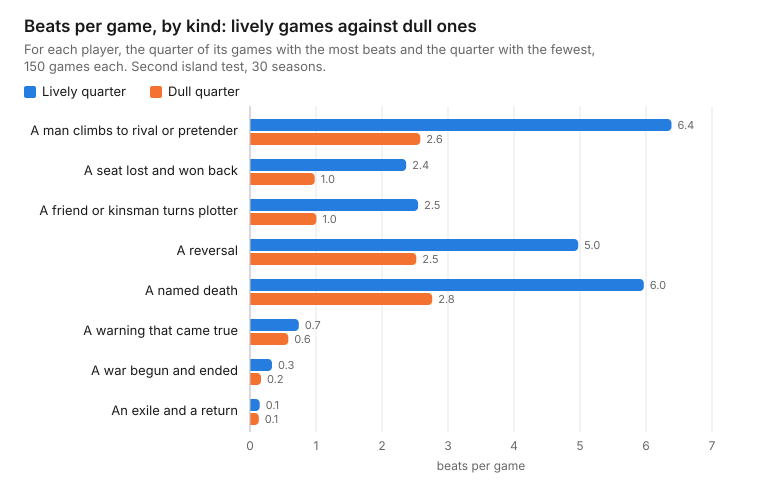
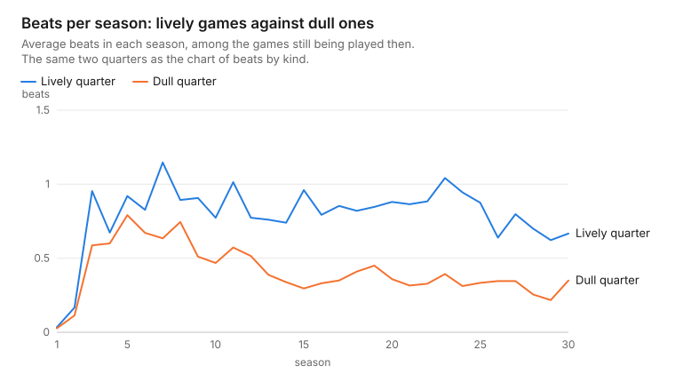

# Do ten seasons make a story you would retell?

27 November 2026. 600 games of the Second island test, played by the playtest bot's three players, 30 seasons each. Report only: nothing in the game was changed.

## The answer

**Mostly no, not in ten seasons.** By season 10, only 1 game in 10 for the careful ruler, and about 1 in 8 for the patron, has both a man with a story (someone who, say, rises against you and then turns plotter) and something that began and closed (a seat won back, a warning come true, a war ended, a return from exile). The iron hand gets there in 1 game in 3, but it is the same story nearly every time: a purge of the family, in much the same order.

The things that make a story, Carthage, a plot that strikes, a flight into exile, mostly come between seasons 15 and 25. By season 30 many games do have a story worth telling. Of the ten games retold below, six are worth retelling as a story and two more as a one-liner.

**The beat count does not tell a good game from a dull one.** All five of the busiest games are the same purge, told again. Two of the five quietest are among the best stories of the ten: a fall, an exile, a desperate try at coming home. What makes a game worth retelling is a thread that comes back and closes: the man you wronged who returns with an army, the siege broken by plague. The count rewards how many things happen, not whether they connect.

The earlier ten-season read of the First island test ([2026-11-23-ten-seasons.md](../2026-11-23-ten-seasons.md)) found 7 of 20 games worth retelling. That fits the iron hand here, and is kinder than the careful ruler and the patron.

The full numbers are in [results.md](results.md). Every game is listed, with its replay command, in [games.md](games.md). Each of the ten games below has its own sheet in [sheets/](sheets/).

## How it was measured

The playtest bot played seeds 1 to 200 with each of its three players: the careful ruler, the patron and the iron hand. Every game ran 30 seasons, or until the ruler died. A new script reads each game's log, only the lines the player can see, and counts eight kinds of story beat:

| Beat | What it reads in the log |
| --- | --- |
| A man climbs to rival or pretender | "Hipparinus becomes a political rival", "... is now a Pretender", "... is now your Nemesis" (the opening's cast in season 1 is left out) |
| A seat lost and won back | "Nicoteles holds the fleet", then later "You hold the fleet" |
| A friend or kinsman turns plotter | "Leptines is in a plot against you", when he is family or once liked you |
| A reversal | silver, the guard, the army or a faction's mood climbs, then falls by half or more |
| A named death | "Thearides is dead.", "Himilcon ... starves himself to death", your own death |
| A warning that came true | "Whispers: ..." and later "The plot strikes."; a town warned of hunger that then starves |
| A war begun and ended | "Carthage declares war on Syracuse", later "Peace is made" |
| An exile and a return | "You flee to Leontini", later "You come home. Syracuse is yours again." |

The exact wording each beat reads, and its edge cases, are in [results.md](results.md#what-counts-as-a-beat). The script also finds each game's longest quiet stretch (the most seasons in a row with no beat) and counts the sentences a player sees most, with names and numbers taken out.

Every game ran without a crash, every state checked out, and replaying each game's moves gave the same game. Running the script again writes the same files.

## What the numbers say

### By player

|  | Careful ruler | Patron | Iron hand |
| --- | ---: | ---: | ---: |
| Beats per game (middle game) | 12 | 14 | 26 |
| Beats in the first ten seasons, average | 3.1 | 4.5 | 10.5 |
| Longest quiet stretch, middle game | 5 seasons | 4 seasons | 4 seasons |
| Games with 8 or more quiet seasons in a row | 25% | 16% | 14% |
| Still ruling after 30 seasons | 170 of 200 | 176 of 200 | 86 of 200 |
| Killed before then | 19 | 8 | 71 |

The iron hand's extra beats are almost all executions: about 10 a game, none at all for the other two. Hipparinus is the first to die in 140 of its 200 games. Every player sees about five of the eight kinds of beat in a game. Wars ended and exiles with a return are rare for everyone: a war is begun and ended in 23% of games, an exile ends in a return in 14%.

### The first ten seasons

|  | Careful ruler | Patron | Iron hand |
| --- | ---: | ---: | ---: |
| Beats, middle game | 3 | 4 | 11 |
| A man with a story by season 10 | 12% | 26% | 86% |
| Something begun and closed | 51% | 41% | 37% |
| ... not counting the generalship won back | 9% | 19% | 28% |
| Both a man with a story and something closed | **10%** | **13%** | **32%** |

The generalship changes hands so often (given away, lost at the spring vote, handed back when its holder is arrested) that winning it back is most of the "something closed" early on. "You win back the generalship" is the commonest beat in the whole run, seen in 352 of 600 games. Leave it out and only 9% of careful games and 19% of patron games have closed anything by season 10.

Seasons 1 and 2 have almost no beats: 17 of the 600 games have one in season 1, and 67 in season 2.

### When the big things happen

| First time it happens | Careful ruler | Patron | Iron hand |
| --- | ---: | ---: | ---: |
| Carthage declares war: by season 10 | 7% | 3% | 5% |
| ... in the middle game, season | 16 | 17 | 16 |
| A plot strikes at you: by season 10 | 2% | 0% | 17% |
| ... ever, in 30 seasons | 16% | 7% | 63% |
| You flee into exile: by season 10 | 2% | 1% | 10% |
| ... ever, in 30 seasons | 18% | 27% | 38% |

Carthage comes in almost every game, but a season or six after the ten. A plot strikes in only 171 of the 600 games, though every game is full of whispers about one (see Repetition).

### Quiet stretches

The longest quiet stretch most often starts early: in seasons 1 to 10 in 311 of the 600 games. The careful ruler has the longest: a quarter of its games go 8 seasons or more without a beat, and one goes 19. Dull games are quiet in the middle of the game, not at the start (see the second chart).

### Repetition

A player sees about 1,800 sentences a game, of 4,820 different ones across the run. The 40 commonest are 41% of everything seen. Most of those are numbers moving ("Silver +2 (now 14)" about 143 times a game). Among the news a player reads:

- "Carthage's ships trade along the coasts." 25 times a game, in every game: nearly every season.
- "Whispers: ..." 36 times a game, in every game. A plot strikes in fewer than 1 game in 3.
- "... petition goes unanswered." 14 times a game, and "... leaves without a word." 6 times.
- "Stories about you spread among ..." about 15 times a game.
- "Aristotle the Spartan demands citizenship for the guard" comes back season after season, counted up to "(the fifth time)" and beyond.

Wording faults a player sees:

- "You's hold on the treasury: Dug in." (and the same for the mint, the fleet, the generalship, the citadel): about 20 times a game, in 598 of the 600 games.
- "You learn that The brother of Demarchus leads a plot against you": a capital letter in the middle of the sentence.
- "Theste came to your door: someone among the rich families tried to win him over": Theste is a woman.
- The exile death "You fall in the market place, as Hermocrates did when he tried to come home" ends 18 games, even when you were hiding in Messana and not coming home at all (iron hand seed 9).

Two battles at Gela in one season looked like a repeated line, but they are two real battles.

## Ten games, retold

The five games with the most beats and the five with the fewest, of all 600. Every one of the ten is the iron hand or the careful ruler. Each is told as a friend would tell it over a drink, then a line on what the count saw. To replay one, run its command; add `--log` to see every line the player saw.

### The most beats

**1. The iron hand, seed 98: 39 beats, still ruling.** Would retell, once.

> This one's a bloodbath. I start by executing Demarchus's brother, then Hipparinus's daughter Aristomache, so Hipparinus swears a feud, climbs all the way to Nemesis and goes to the block himself. After that it's one a season: Theodorus, Damon the smith, my brother Thearides, Philistus, the captain of my guard. Every death hands the feud to the next of kin, so my sister Theste and her husband go the same way. Sixteen executions. Then Carthage lands 50,000 men. I beat Himilcon at Messana, take his silver to let his men sail home by night, and he starves himself to death in shame. I end it still on the throne, nearly alone, with my brother Leptines, the one who slipped my guards, back in the city as a rival.

`node scripts/story-metrics.ts --one tyrant:98`. The count saw 39 beats and no quiet stretch over 3 seasons. It is the same purge as seeds 116, 44, 169 and 45.

**2. The iron hand, seed 116: 39 beats, in exile at the end.** Would retell.

> Fourteen executions, and you can watch the feud walk down my family: Leptines, then Thearides, then our sister Theste, then her husband Polyxenus, each swearing vengeance for the last. Then Hipparinus, Aristomache, Andron who kept the fortress, Philistus. The one I never caught was Heloris, the old man some call my adoptive father. I refused him the citadel twice, the second time in front of the family, and he slipped away to the exiles. When Carthage came I lost a 45,000-man army at Gela. In season 29 I scraped up 10,000 men and marched out, leaving nobody to keep the citadel, and Heloris's plot took the Island behind me. My army went home to its new master. I fled to Leontini alone, without a coin.

`node scripts/story-metrics.ts --one tyrant:116`. The count saw the purge. What makes it is Heloris, refused the citadel in seasons 11 and 15 and back in season 29, which the count sees only as separate beats.

**3. The iron hand, seed 44: 38 beats, still ruling.** Would retell.

> The same purge as the others, fifteen executions, starting with Hipparinus in season 3 and running through both my brothers, my sister and her husband until there's hardly anyone left at court. What makes this one is the end. Carthage declares war in season 20 and Himilcon lands 50,000 men. They besiege Messana, and the defenders sally out by night and burn the siege works. Then he brings the whole army to Syracuse and sits outside my walls for a year. In season 28 plague breaks out in his camp, I attack at dawn by land and sea, and his army is destroyed. He goes home in disgrace and starves himself to death. Still ruling at the end.

`node scripts/story-metrics.ts --one tyrant:44`. The count saw the purge and one death for Himilcon. The siege and the plague, the best part, are not a beat at all, because the war never formally ends.

**4. The iron hand, seed 169: 38 beats, in exile at the end.** Would retell.

> Sixteen executions: my brothers, my sister, Hipparinus and his daughter, half the court. The one who got away was Philistus, my rich backer. In season 13 I emptied his strongrooms and ignored his request for the treasury, and the next season he slipped my guards. Carthage lands 50,000 men in season 20. I win once at Gela, lose twice there, and the army is gone. A plot wounds me in season 25 and I live. I raise 30,000 more, beat Himilcon at Messana, and take his silver to let his men sail home by night. Then in season 29 Philistus's plot takes the Island and I run to Leontini with one talent and two companies of hired men.

`node scripts/story-metrics.ts --one tyrant:169`. The count saw the purge. The story is Philistus: wronged in season 13, back in season 29.

**5. The iron hand, seed 45: 37 beats, still ruling.** So-so: the war half is good, the rest is the purge again.

> Thirteen executions, the usual list. But this was the war game. Carthage lands 50,000 in season 20 and I meet them with 55,000. I win at Gela, then at Panormus, and Himilcon's army is gone. He goes home in disgrace and starves himself. I besiege Panormus until my own army eats the last of its food and breaks up in season 24. Then in season 29 Magon lands 30,000 more at Motya, and I can only muster 15,000. When Carthage puts Magon on trial for the war, I spread word that he's in my pay, and they call him home to answer for it. Still ruling, still at war.

`node scripts/story-metrics.ts --one tyrant:45`. The count saw the purge, three reversals and one warning come true. The rumor about Magon, the best moment, lands in the very last season and is not a beat.

### The fewest beats

**6. The careful ruler, seed 46: 3 beats, still ruling.** Would not retell: things happen, but nothing comes to anything.

> Not much to tell, and that's the point. The assembly takes the generalship off me in season 4 and never gives it back, and Hipparinus gets the fleet. I never make the guard citizens, so they turn kingmaker, and then I can't pay them: "the guard goes unpaid" nearly every season for five years. Leptines keeps winning friends in the guard, five times over, and nothing ever comes of it. In season 13 I arrest Hipparinus and Demarchus's brother over a plot. Carthage declares war, plague hits Carthage, we make peace. They come back, Messana starves and gives in, and in the very last season Syracuse is starving, Carthage's fleet rows into the Great Harbour, and the Locrians agree to my marriage to Doris. Then the game stops.

`node scripts/story-metrics.ts --one careful:46`. The count saw a ten-season quiet stretch, the longest of the ten. Every big moment comes in the last two seasons, and Syracuse falls the season after the game stops.

**7. The iron hand, seed 198: 3 beats, killed in season 18.** Would retell.

> Hipparinus wants my place from season 4, and by season 6 two factions are calling him the man who should rule. The guard goes unpaid, and in season 9 they switch their backing to him and that's it: I'm out, running to Leontini with Philistus, Heloris, Andron and Polyxenus, no silver and one company of hired men. Sparta sends silver and a captain, a Persian satrap's agent pays me a fortune, and I keep my men sweet by promising them the plunder of the tyrant's house. Then Carthage besieges Syracuse, a Carthaginian merchant brings silver to put me back, and Hipparinus marches out to fight and leaves the Island to his captains. I make my move and fall in the market place, just like Hermocrates.

`node scripts/story-metrics.ts --one tyrant:198`. The count saw only a rise, one execution and my death. The whole exile, which is the story, scores nothing because it never ends in a return.

**8. The iron hand, seed 9: 3 beats, killed in season 12.** Would retell.

> In season 2 my men catch a messenger with a sealed letter from the exiles to Demarchus's brother. I read it, seal it again and send it on. I'm tyrant by season 3. By season 5 Hipparinus, Demarchus's brother, Leptines and Aristomache have all slipped away, the plot strikes, the Island falls and the exiles' leader rules Syracuse. I flee to Leontini. Sparta sends a captain, a Persian pays me, and the city offers to let me come home as a private man. I refuse, and my men with families in the city take the offer without me. Then letters I wrote are found, and my friends inside, Polyxenus and then Philistus, are seized. I slip away to Messana just as Carthage besieges it, and fall in the market place in season 12.

`node scripts/story-metrics.ts --one tyrant:9`. The count saw a turncoat, a warning come true and my death. The letters, the offer to come home and the friends seized one by one are not beats.

**9. The iron hand, seed 76: 4 beats, killed in season 5.** A one-liner: "five seasons, one long fuse."

> Short and brutal. I take the mint off Hipparinus, the assembly off Nicoteles and the fleet off my brother Leptines, finish the citadel, and I'm tyrant in season 3. Andron, who keeps the fortress, confesses that Demarchus's brother urged him to seize it, and I say nothing and have them both watched. Hipparinus threatens to tell the city I staged the night alarm that won me my bodyguard, and then does. Demarchus's brother slips away and builds a plot with Hipparinus, Leptines and Nicoteles. In season 5 I find Nicoteles in it and have him executed. The plot strikes that same season and I'm dead.

`node scripts/story-metrics.ts --one tyrant:76`. The count saw four beats, all in season 5.

**10. The careful ruler, seed 189: 4 beats, killed in season 4.** A one-liner: "I fined a man for light coin and he had me killed a year later."

> In season 1 Hipparinus's coins from the mint come out light, and I fine him the difference. He doesn't forget. I never make the guard citizens, so by season 2 they're selling their loyalty. Nicoteles takes the fleet, then the assembly takes the generalship from me and he gets that too. In season 4 Hipparinus asks for the generalship in front of the rich families, I don't answer, and the plot strikes that same season. The sword falls, and Hipparinus leads the men who kill me. My brother Thearides dies of a fever the same season. Four seasons, and the whole thing turns on a fine for light coin.

`node scripts/story-metrics.ts --one careful:189`. The count saw a rise, two deaths and the warning that came true. The game's own chronicle names the thread ("it began when you fined him for the coin"), which the count does not read.

### What the ten show

Six of the ten are worth retelling as a story (seeds 98, 116, 44, 169, 198 and 9), two more as a one-liner (76 and 189), and two hardly (45 and careful 46). The count does not sort them: all five of the busiest games are one purge told again, and two of the quietest (seeds 198 and 9) are among the best stories. The good ones all have a man or a danger that comes back: Heloris, Philistus, Himilcon's siege, the exile's long try at coming home. The count reads beats one at a time and misses the thread between them. It also gives nothing for an exile with no return, a seat lost for good or a war still going at season 30, though those are often the best part.

For comparison, the ten quietest games that ran the full 30 seasons are all the careful ruler's. Their sheets are not written, but each has a replay command in [games.md](games.md).

## What separates lively games from dull ones

For each player, its quarter with the most beats (the lively quarter) is set against its quarter with the fewest (the dull quarter): 150 games each. Taking quarters inside each player stops the iron hand's executions from filling the lively side by themselves.





1. **People.** Lively games put twice as many people into a beat: 9.2 people (not counting you) against 4.7. More men climb to rival (6.4 a game against 2.6), more friends and kin turn plotter (2.6 against 1.0) and more of them die (6.0 against 2.8).
2. **The middle of the game.** Both quarters run at about the same pace up to season 8. From season 9 the dull games drop to about a third of a beat a season while the lively ones stay near one. Dull games don't start dull: they run dry. Their longest quiet stretch averages 6.8 seasons against 4.0.
3. **Not the big set pieces.** Warnings come true about as often in both (0.7 against 0.6 a game), and so do exiles with a return (0.15 against 0.13). Wars ended are rare in both (0.3 against 0.2). Plots strike a little more often in dull games (0.39 against 0.33). Nearly three quarters of both end with a war still going.
4. **Length.** Dull games are shorter: 25 seasons against 30 on average, and 45 of the 150 dull games end in your death, against 13 of the lively. For the iron hand, a dull game is mostly one that ended early: its dull quarter lasted 19 seasons on average, and 34 of its 50 games ended in death.
5. **More to decide.** Lively games put more matters to the player (74 against 61 a game) and the player takes more actions (86 against 75), of slightly more kinds.

The two charts sum it up: the gap is mostly people and swings, not wars or exiles, and it opens up in the middle of the game.

## Ideas

Each is marked cheap or costly. The top five are starred.

1. ★ **Fix "You's hold on the treasury" (cheap).** It is the commonest broken sentence in the game: about 20 times a game, in nearly every game. It should read "Your hold on the treasury".
2. ★ **Fewer, truer whispers (cheap).** Whispers come 36 times a game, but a plot strikes in fewer than 1 game in 3. Show a warning only when there is a plot that can really strike, and show fewer of them, so that a whisper is news.
3. ★ **Bring Carthage on stage before season 10 (costly).** Carthage is the biggest story maker, but it declares war by season 10 in only 3 to 7 games in 100, and in the middle game not until season 16 or 17. A raid, an envoy with demands or a landing at Motya in the first ten seasons would give the ten-season test something to close.
4. ★ **Keep the court making new people after season 8 (costly).** This is where dull games run dry. A son coming of age, an exile coming back, a newcomer from Corinth or Sparta who wants a seat: anyone new to rise, turn or fall.
5. ★ **Close the open threads in the end-of-game story (cheap).** Name what was left hanging: the brother who got away (seed 98), the war still going (seed 45), the exile not over (seeds 116 and 169), the fleet in the Great Harbour (careful seed 46). The best part of many games is a thread the game never finishes saying.
6. **Fold repeated news (cheap).** "Carthage's ships trade along the coasts" every season, unanswered petitions, "leaves without a word", "stories about you spread". Say each once, or once with a count, rather than every season.
7. **Fix the other wording faults (cheap).** The capital letter in "You learn that The brother of Demarchus", and "him" for Theste in the plot warning.
8. **Vary the exile death (cheap).** "You fall in the market place, as Hermocrates did when he tried to come home" ends 18 games, including ones where you were hiding in Messana rather than coming home.
9. **Let a feud end, or let a kinsman refuse it (costly).** The iron hand's five busiest games are the same purge, in nearly the same order, with Hipparinus first in 140 of 200 games. If a brother or sister could refuse the feud, or make peace, the purges would stop telling the same story.
10. **Count the Second island test at its full 40 seasons (cheap).** At 30 seasons, about 72% of games end with a war still going. A 40-season run would show whether those wars close.
11. **Add the beat counter to the playtest bot's report (cheap).** Then every change shows whether it made games livelier or duller, next to the other checks.
12. **Check the count against a reader (cheap).** Jacob reads three of the ten sheets and says which he would retell, to see whether the count and a reader agree.

## Checks

- **The tests:** 203 tests, 202 passed, none failed, 1 skipped. The skipped one, "the Dionysius card quotes what the saved Diodorus says", needs the Diodorus text from a sibling folder that this machine doesn't have. The run took about two minutes.
- **The 100-seed check** (the default scenario, the citadel game, played by the simple bot): no crashes and no broken states. Games lasted 11.9 seasons on average. Of 100 games, 19 ended in exile, 27 in death and 54 deposed. Plots 4.1 a game, strikes 0.5. It printed one warning: "costs that changed nothing", 11.2 a game against a limit of 10, all from a faction already Rebellious being asked to sour further. The repetition check, which only reports, found the commonest line at 6.1 times a game and the worst, a Whispers line, 21 times in seed 53.

Both ran on the Node already on this machine. No packages were installed.

## Notes on this run

- Only new files: the story counter and this folder. Nothing in the game, the interface, the data, the tests or the package file was touched.
- The project's instructions say to update the hand-off and decisions notes after a change. This job said new files only, so both are left as they were.
- The playtest bot was already on main, so this branch starts from main.
- The counter cuts each game at the end of season 30. A few games end in the opening of season 31 (careful seed 46 loses Syracuse there); those count as still ruling or in exile, as the player last saw them at season 30.

To run it again:

```
node scripts/story-metrics.ts
```

To replay one game, with every line the player saw:

```
node scripts/story-metrics.ts --one careful:46 --log
```
