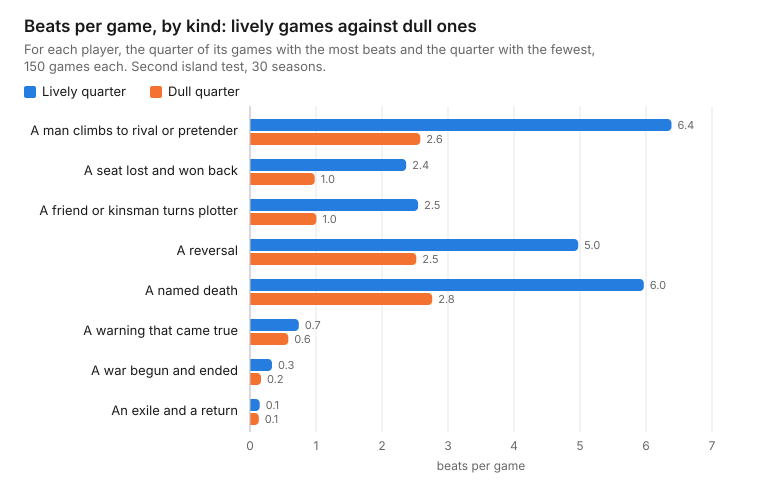
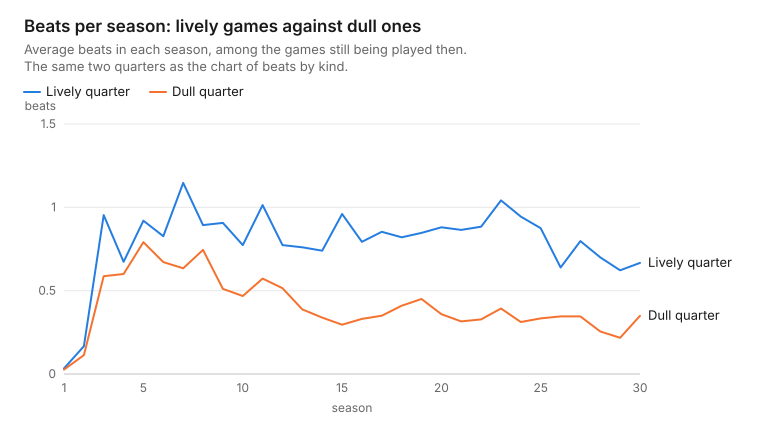

# Story metrics: the numbers

Written by `node scripts/story-metrics.ts`. 600 games of the Second island test, 30 seasons each (or until the ruler falls): 200 each for the careful ruler, the patron, the iron hand, seeds 1 to 200. The players are the playtest bot's. The report that reads these numbers is [report.md](report.md); every game is listed in [games.md](games.md).

Every game ran without a crash, every game's state checked out at the end, and replaying each game's moves gave the same game.

## What counts as a beat

A beat is something a player would mention when telling someone about the game. Each is read from the lines the player can see in the log; the quotes are the game's own words.

- **A man climbs to rival or pretender.** "X no longer hides it: he wants your place", "X is a rival (or a pretender) in the city now", "Two factions now speak of X as the man who should rule Syracuse", "X becomes a political rival", "X is now a Pretender", "X becomes your rival", "X is your rival again", "X is now your Nemesis". One beat each time a man who is not a rival of any kind becomes one, and again when he first reaches pretender (a Pretender or a Nemesis). He can climb again after a line says he is no longer one. The first season's are left out: they come from the opening's cast (in nearly every game Leptines and Hipparinus are named political rivals at the end of season 1), not from play.
- **A seat lost and won back.** "X holds the fleet" (or "The fleet stands empty", "X commands the guard") for a seat you held, then "You hold the fleet" (or "You command the guard") in a later season. Seats won back in one season are one beat. Seats lost by falling into exile and given back by coming home are left out: that is the exile beat.
- **A friend or kinsman turns plotter.** The first line that shows you a man in a plot against you: "X is in a plot against you", "You learn that X leads a plot", "... is sworn into Y's plot", "The names now spoken: X", "Every plotter is named: X, Y", "X joins Y's plot", "You are killed by men you trusted. X led them". It counts when X is your kin (your family by blood or marriage, or the ruler's family) or a friend (his opinion of you was +2 or more at some point before). Once per man in a game: a friend turns once, and the same man found in a plot again later is not a new beat.
- **A reversal.** "Silver +3 (now 14)" and the like: silver climbs at least 5 to at least 10, then falls to half its peak or less. "Guard strength": climbs at least 2 to at least 4, then halves. "You muster the army ... about 9,000 men" and "Your army loses about 2,000 men (now about ...)": the army falls to half its size or less by losses ("Your army is destroyed" counts; disbanding does not). "The citizens warm to Content" and "sour to Angry": a faction's mood climbs two steps or more to Content or Loyal, then falls two steps or more (half the five-step scale). A see-saw between Rebellious and Uneasy is not counted: it is counted on its own, as churn. One beat each time; it starts again from the low.
- **A named death.** "X is dead." for anyone of the cast (the households' background deaths, "X son of Y died, aged 48", are left out); "Himilcon ... starves himself to death"; "X falls in the battle" (a Carthaginian general); and your own death ("The sword falls. You are killed ...", "Assassins ... find you"). Once per person.
- **A warning that came true.** A plot warning ("Whispers: ...", "Rumors: ...", "Named: ...") and then, in a later season, "The plot strikes." (or, in exile, "The hunters strike"); "X's army eats the last of its food" and then "X's army has run out of food" within two seasons; "Messana has 2 months of grain left under siege" and then "Messana has eaten its last grain and gives in" (or "Syracuse is starving") within three seasons. Once per blow, per hunger, per town starved.
- **A war begun and ended.** "Carthage declares war on Syracuse" (or "Syracuse is at war with Carthage", "You declare war on Carthage") and later "Peace is made between Syracuse and Carthage". A war still going at the end is not a beat.
- **An exile and a return.** "You are not finished. You flee to ..." and later "You come home. ... Syracuse is yours again." An exile with no return is not a beat.

The **longest quiet stretch** is the longest run of seasons with no beat in it. A season with the first half of a two-part beat that later closed (a seat lost, a war begun, a flight into exile) is not quiet.

**Churn** is not a beat: it counts each time a faction sours back to Rebellious. It is here because it is the commonest swing in the game and it never makes a beat on its own.

## Each player's games

|  | the careful ruler | the patron | the iron hand |
| --- | ---: | ---: | ---: |
| Games | 200 | 200 | 200 |
| Still ruling after 30 seasons | 181 | 192 | 129 |
| Killed before then | 19 | 8 | 71 |
| Seasons played, on average | 29.0 | 29.8 | 26.0 |
| Beats per game: average | 12.6 | 14.4 | 25.1 |
| Beats per game: middle game | 12 | 14 | 26 |
| Beats per game: fewest to most | 3 to 28 | 7 to 25 | 3 to 39 |
| Kinds of beat per game (of 8), average | 5.0 | 5.1 | 5.3 |
| Beats in the first ten seasons, average | 3.1 | 4.5 | 10.5 |
| Longest quiet stretch: average | 6.1 | 5.1 | 4.5 |
| Longest quiet stretch: middle game | 5 | 4 | 4 |
| Longest quiet stretch: the longest | 19 | 15 | 14 |
| Games with a quiet stretch of 8 seasons or more | 25% | 16% | 14% |
| Churn per game (a faction back to Rebellious) | 12.6 | 10.6 | 10.7 |
| Lines seen per game | 1272 | 1263 | 1079 |

## Beats by kind

Average per game, and in brackets the share of games with at least one.

| Beat | the careful ruler | the patron | the iron hand | All games |
| --- | ---: | ---: | ---: | ---: |
| A man climbs to rival or pretender | 3.29 (98%) | 3.54 (99%) | 7.26 (99%) | 4.70 (99%) |
| A seat lost and won back | 2.12 (89%) | 2.10 (81%) | 0.73 (56%) | 1.65 (75%) |
| A friend or kinsman turns plotter | 1.49 (78%) | 1.14 (81%) | 2.67 (91%) | 1.77 (83%) |
| A reversal | 3.69 (96%) | 5.75 (100%) | 1.62 (75%) | 3.69 (90%) |
| A named death | 1.13 (76%) | 1.03 (74%) | 11.40 (100%) | 4.52 (83%) |
| A warning that came true | 0.47 (33%) | 0.42 (36%) | 1.01 (74%) | 0.64 (47%) |
| A war begun and ended | 0.28 (28%) | 0.25 (25%) | 0.17 (18%) | 0.23 (23%) |
| An exile and a return | 0.10 (9%) | 0.17 (17%) | 0.17 (17%) | 0.15 (14%) |

### What the beats mostly are

The five commonest beats of each kind across all games, names kept, with how many games had each.

- **A man climbs to rival or pretender:** "Nicoteles becomes a rival" (254); "Theodorus becomes a rival" (242); "Damon the smith becomes a rival" (176); "Aristomache becomes a rival" (175); "Leptines becomes a rival" (172).
- **A seat lost and won back:** "You win back the generalship" (352); "You win back the assembly" (158); "You win back the generalship and the assembly" (74); "You win back the fleet" (73); "You win back the assembly and the generalship" (24).
- **A friend or kinsman turns plotter:** "Hipparinus, once your friend, is in a plot against you" (279); "Leptines, your kin, is in a plot against you" (163); "Theste, your kin, is in a plot against you" (102); "Andron, your kin, is in a plot against you" (96); "Thearides, your kin, is in a plot against you" (81).
- **A reversal:** "The citizens warm from Rebellious to Content, then sour to Angry" (336); "The citizens warm from Rebellious to Loyal, then sour to Uneasy" (247); "The rich families warm from Rebellious to Content, then sour to Angry" (227); "The citizens warm from Angry to Content, then sour to Angry" (98); "The rich families warm from Rebellious to Loyal, then sour to Uneasy" (87).
- **A named death:** "Himilcon starves himself to death in Carthage" (270); "Hipparinus dies (executed)" (181); "The brother of Demarchus dies (executed)" (179); "Aristomache dies (executed)" (165); "Nicoteles dies (executed)" (163).
- **A warning that came true:** "A blow warned of since [a season] falls" (172); "Syracuse, warned its grain was nearly gone, starves" (62); "Messana, warned its grain was nearly gone, starves" (46); "Your army, warned it was eating the last of its food, runs out" (32); "Motya, warned its grain was nearly gone, starves" (7).
- **A war begun and ended:** "A war with Carthage, [a season] to [a season]" (140).
- **An exile and a return:** "Exiled in [a season], home in [a season]" (84).

## The first ten seasons

What a player has to tell after ten seasons. **A man with a story**: someone (not you) in two kinds of beat by then, for instance he rises and then turns plotter, or turns plotter and is executed. **Something begun and closed**: a seat won back, a warning come true, a war ended or a return from exile. The generalship changes hands often (given to a man who asks for it, lost at the spring vote, handed back when its holder is arrested), so the line below that one leaves out the generalship won back on its own.

|  | the careful ruler | the patron | the iron hand |
| --- | ---: | ---: | ---: |
| Beats, middle game | 3 | 4 | 11 |
| Kinds of beat, middle game | 2 | 3 | 3 |
| Games with no beat at all | 7% | 2% | 0% |
| Games with three kinds of beat or more | 45% | 62% | 75% |
| Games with a man with a story | 12% | 26% | 86% |
| Games with something begun and closed | 51% | 41% | 37% |
| ... leaving out the generalship won back | 9% | 19% | 28% |
| Games with both a man with a story and something closed | 10% | 13% | 32% |

## Quiet stretches

How long each game's longest stretch with no beat is, and where in the game it falls.

| Longest quiet stretch | the careful ruler | the patron | the iron hand |
| --- | ---: | ---: | ---: |
| 0 to 2 seasons | 3 | 8 | 35 |
| 3 to 4 seasons | 67 | 95 | 95 |
| 5 to 6 seasons | 61 | 50 | 31 |
| 7 to 9 seasons | 40 | 39 | 30 |
| 10 to 14 seasons | 27 | 7 | 9 |
| 15 to 30 seasons | 2 | 1 | 0 |

| It starts in | the careful ruler | the patron | the iron hand |
| --- | ---: | ---: | ---: |
| seasons 1 to 10 | 111 | 110 | 90 |
| seasons 11 to 20 | 64 | 56 | 47 |
| seasons 21 to 30 | 25 | 34 | 63 |

## Lively games against dull ones

For each player, the quarter of its games with the most beats (the lively quarter) and the quarter with the fewest (the dull quarter), 150 games each. Taking quarters inside each player keeps the iron hand's busy games from filling the lively quarter by themselves. These are the tables behind the two charts.

| Per game | Lively quarter | Dull quarter |
| --- | ---: | ---: |
| Beats | 23.5 | 10.7 |
| A man climbs to rival or pretender | 6.39 | 2.58 |
| A seat lost and won back | 2.37 | 0.98 |
| A friend or kinsman turns plotter | 2.55 | 1.01 |
| A reversal | 4.97 | 2.52 |
| A named death | 5.97 | 2.76 |
| A warning that came true | 0.74 | 0.58 |
| A war begun and ended | 0.33 | 0.17 |
| An exile and a return | 0.15 | 0.13 |
| Kinds of beat (of 8) | 5.6 | 4.6 |
| People (not you) in a beat | 9.2 | 4.7 |
| Season of the first beat | 3.5 | 4.6 |
| Longest quiet stretch, seasons | 4.0 | 6.8 |
| Seasons played | 29.6 | 25.4 |
| Killed before season 30 | 13 of 150 | 45 of 150 |
| Carthaginian landings | 1.28 | 1.01 |
| Battles | 1.85 | 0.92 |
| A war still going at the end | 72% | 73% |
| Plots that struck | 0.33 | 0.39 |
| Matters put to the player ("You choose") | 74.3 | 60.6 |
| Actions taken | 86.2 | 75.1 |
| Different actions taken | 19.4 | 17.2 |
| Churn (a faction back to Rebellious) | 11.9 | 10.6 |

The same comparison inside each player:

| Per game | the careful ruler, lively | dull | the patron, lively | dull | the iron hand, lively | dull |
| --- | ---: | ---: | ---: | ---: | ---: | ---: |
| Beats | 18.0 | 7.7 | 18.8 | 10.1 | 33.6 | 14.3 |
| A man climbs to rival or pretender | 4.28 | 2.04 | 4.28 | 2.44 | 10.60 | 3.26 |
| A seat lost and won back | 3.12 | 1.14 | 3.14 | 1.28 | 0.84 | 0.52 |
| A friend or kinsman turns plotter | 2.50 | 0.66 | 1.60 | 0.86 | 3.54 | 1.50 |
| A reversal | 5.38 | 2.36 | 7.14 | 4.16 | 2.40 | 1.04 |
| A named death | 1.50 | 0.84 | 1.40 | 0.74 | 15.00 | 6.70 |
| A warning that came true | 0.72 | 0.32 | 0.68 | 0.28 | 0.82 | 1.14 |
| A war begun and ended | 0.40 | 0.24 | 0.34 | 0.22 | 0.26 | 0.04 |
| An exile and a return | 0.08 | 0.14 | 0.20 | 0.12 | 0.16 | 0.14 |
| People in a beat | 6.1 | 3.0 | 4.7 | 2.9 | 16.9 | 8.3 |
| Longest quiet stretch | 4.6 | 8.5 | 3.8 | 6.7 | 3.7 | 5.1 |
| Seasons played | 29.8 | 28.4 | 30.0 | 29.3 | 29.0 | 18.7 |
| Killed before season 30 | 3 | 6 | 0 | 5 | 10 | 34 |

| Season | Lively: beats | games going | Dull: beats | games going |
| --- | ---: | ---: | ---: | ---: |
| 1 | 0.03 | 150 | 0.03 | 150 |
| 2 | 0.17 | 150 | 0.11 | 150 |
| 3 | 0.95 | 150 | 0.59 | 150 |
| 4 | 0.67 | 150 | 0.60 | 150 |
| 5 | 0.92 | 150 | 0.79 | 148 |
| 6 | 0.83 | 150 | 0.67 | 146 |
| 7 | 1.15 | 150 | 0.63 | 145 |
| 8 | 0.89 | 150 | 0.74 | 145 |
| 9 | 0.91 | 150 | 0.51 | 143 |
| 10 | 0.77 | 150 | 0.47 | 141 |
| 11 | 1.01 | 150 | 0.57 | 138 |
| 12 | 0.77 | 150 | 0.51 | 134 |
| 13 | 0.76 | 150 | 0.39 | 129 |
| 14 | 0.74 | 150 | 0.34 | 127 |
| 15 | 0.96 | 150 | 0.30 | 125 |
| 16 | 0.79 | 150 | 0.33 | 124 |
| 17 | 0.85 | 150 | 0.35 | 123 |
| 18 | 0.82 | 150 | 0.41 | 122 |
| 19 | 0.85 | 150 | 0.45 | 120 |
| 20 | 0.88 | 150 | 0.36 | 117 |
| 21 | 0.86 | 148 | 0.32 | 114 |
| 22 | 0.88 | 146 | 0.33 | 113 |
| 23 | 1.04 | 145 | 0.39 | 112 |
| 24 | 0.94 | 144 | 0.31 | 109 |
| 25 | 0.88 | 144 | 0.33 | 108 |
| 26 | 0.64 | 144 | 0.35 | 107 |
| 27 | 0.80 | 143 | 0.35 | 107 |
| 28 | 0.70 | 143 | 0.25 | 106 |
| 29 | 0.62 | 143 | 0.22 | 106 |
| 30 | 0.67 | 141 | 0.35 | 106 |

## The sentences a player sees most

Every line the player can see, cut into sentences, with names put as [someone], towns as [a town] and numbers as N. Across the 600 games a player sees 1815 sentences a game, of 4820 different ones. The 40 commonest are 41% of everything seen. "News" marks a sentence from an event or a warning; the rest are results, rolls and changes to the numbers.

|  | Sentence | Per game | the careful ruler | the patron | the iron hand | Games with it | News |
| ---: | --- | ---: | ---: | ---: | ---: | ---: | --- |
| 1 | "Silver N (now N)." | 142.8 | 156.9 | 148.4 | 123.0 | 100% |  |
| 2 | "You choose:" | 68.7 | 74.5 | 79.4 | 52.3 | 100% | news |
| 3 | "Success." | 54.7 | 58.6 | 59.5 | 45.9 | 100% |  |
| 4 | "Grain N months (now N)." | 53.2 | 57.1 | 59.5 | 43.0 | 100% |  |
| 5 | "Whispers:" | 36.0 | 31.0 | 47.5 | 29.6 | 100% | news |
| 6 | "[someone]'s opinion of you falls to N." | 29.6 | 33.1 | 27.0 | 28.7 | 100% |  |
| 7 | "Failure." | 28.1 | 28.5 | 30.0 | 25.7 | 100% |  |
| 8 | "(N silver to Carthage's treasury.)" | 24.6 | 25.2 | 25.8 | 22.8 | 100% | news |
| 9 | "Carthage's ships trade along the coasts." | 24.6 | 25.2 | 25.8 | 22.8 | 100% | news |
| 10 | "[someone]'s opinion of you rises to N." | 22.2 | 25.7 | 25.6 | 15.2 | 100% |  |
| 11 | "[a town]'s grain N months (now N)." | 19.1 | 20.8 | 19.6 | 16.9 | 100% |  |
| 12 | "[someone]'s petition goes unanswered." | 13.8 | 17.1 | 6.7 | 17.5 | 99% | news |
| 13 | "The common citizens power N (now N, Active)." | 13.5 | 12.8 | 12.1 | 15.5 | 100% |  |
| 14 | "The rich families power N (now N, Active)." | 12.8 | 11.4 | 11.8 | 15.1 | 100% |  |
| 15 | "Settled." | 12.2 | 11.2 | 9.3 | 16.0 | 99% |  |
| 16 | "The ruler's family power N (now N, Active)." | 11.4 | 11.6 | 8.6 | 14.0 | 100% |  |
| 17 | "[someone] gathers a following." | 10.0 | 14.1 | 13.3 | 2.6 | 95% | news |
| 18 | "Carthage's anger rises to N of N." | 9.9 | 11.0 | 10.3 | 8.4 | 100% |  |
| 19 | "Watch a person: rolled N N your trait Suspicious = N, needs N." | 9.6 | 11.1 | 11.4 | 6.5 | 99% |  |
| 20 | "The mercenary guard power N (now N, Active)." | 9.4 | 7.7 | 6.8 | 13.7 | 100% |  |
| 21 | "[someone] died, aged N." | 9.0 | 9.4 | 9.2 | 8.5 | 100% | news |
| 22 | "Petition for support: rolled N N their opinion of you N your trait Silver-tongued = N, needs N." | 8.8 | 11.0 | 15.5 | 0.0 | 67% |  |
| 23 | "Dug in." | 8.2 | 7.2 | 7.5 | 9.9 | 100% |  |
| 24 | "Stories about you spread among the citizens." | 7.9 | 6.3 | 7.6 | 9.8 | 99% | news |
| 25 | "[someone] keeps it." | 7.9 | 11.3 | 11.2 | 1.2 | 91% | news |
| 26 | "The rich families:" | 7.8 | 7.9 | 7.5 | 7.9 | 100% |  |
| 27 | "Plant a rumor: rolled N N your trait Silver-tongued = N, needs N." | 7.2 | 8.8 | 12.7 | 0.0 | 64% |  |
| 28 | "Stories about you spread among the rich families." | 7.1 | 5.7 | 11.3 | 4.2 | 97% | news |
| 29 | "Rumors:" | 6.8 | 5.5 | 7.0 | 7.8 | 95% | news |
| 30 | "Your watchers follow [someone]." | 6.8 | 8.1 | 7.7 | 4.6 | 99% | news |
| 31 | "[someone]'s army loses about N men (now about N men)." | 6.4 | 6.5 | 7.2 | 5.6 | 93% |  |
| 32 | "The citizens:" | 6.4 | 6.2 | 6.0 | 6.9 | 100% |  |
| 33 | "[someone] leaves without a word." | 6.3 | 8.4 | 2.6 | 7.8 | 95% | news |
| 34 | "Rebellious, they put their weight behind any plot against you." | 6.2 | 4.8 | 4.1 | 9.8 | 99% |  |
| 35 | "You's hold on the treasury:" | 6.0 | 7.4 | 5.9 | 4.8 | 100% |  |
| 36 | "The mercenary guard power N (now N, Dominant)." | 6.0 | 5.9 | 5.5 | 6.5 | 100% |  |
| 37 | "You N, [someone] N." | 5.9 | 6.6 | 6.5 | 4.5 | 98% | news |
| 38 | "The citizens sour to Rebellious." | 5.6 | 5.9 | 5.3 | 5.7 | 100% |  |
| 39 | "The citizens sour to Angry." | 5.5 | 7.1 | 6.0 | 3.4 | 100% |  |
| 40 | "The tribute of N Sicilian towns reaches Carthage." | 5.5 | 5.1 | 6.0 | 5.4 | 100% | news |

### The news a player sees most

The same count, news only (events and warnings), the 20 commonest.

|  | Sentence | Per game | Games with it |
| ---: | --- | ---: | ---: |
| 1 | "You choose:" | 68.7 | 100% |
| 2 | "Whispers:" | 36.0 | 100% |
| 3 | "(N silver to Carthage's treasury.)" | 24.6 | 100% |
| 4 | "Carthage's ships trade along the coasts." | 24.6 | 100% |
| 5 | "[someone]'s petition goes unanswered." | 13.8 | 99% |
| 6 | "[someone] gathers a following." | 10.0 | 95% |
| 7 | "[someone] died, aged N." | 9.0 | 100% |
| 8 | "Stories about you spread among the citizens." | 7.9 | 99% |
| 9 | "[someone] keeps it." | 7.9 | 91% |
| 10 | "Stories about you spread among the rich families." | 7.1 | 97% |
| 11 | "Rumors:" | 6.8 | 95% |
| 12 | "Your watchers follow [someone]." | 6.8 | 99% |
| 13 | "[someone] leaves without a word." | 6.3 | 95% |
| 14 | "You N, [someone] N." | 5.9 | 98% |
| 15 | "The tribute of N Sicilian towns reaches Carthage." | 5.5 | 100% |
| 16 | "The assembly votes on the leadership of the assembly:" | 5.3 | 100% |
| 17 | "Grain ships come in from abroad." | 5.3 | 95% |
| 18 | "The assembly votes on the generalship:" | 5.2 | 98% |
| 19 | "(about N men hired.)" | 5.2 | 100% |
| 20 | "Carthage sends men with silver to hire soldiers abroad." | 5.2 | 100% |

## The ten games retold

The five games with the most beats and the five with the fewest, of all 600. Ties: for the most, the player's order then the seed; for the fewest, the longer game first (the same beats over more seasons is duller), then the player's order and the seed. Each has a sheet with its beats and the game's own chronicle. Replay one with the command shown; `npm run playtest -- --one second:<player>:<seed>` plays the same game but goes on past season 30.

|  | Player | Seed | Beats | Kinds | Ended | Longest quiet | Sheet | Replay |
| --- | --- | ---: | ---: | ---: | --- | --- | --- | --- |
| Most 1 | the iron hand | 98 | 39 | 6 | still ruling | 3 seasons | [sheet](sheets/iron-hand-98.md) | `node scripts/story-metrics.ts --one tyrant:98` |
| Most 2 | the iron hand | 116 | 39 | 6 | still ruling | 3 seasons | [sheet](sheets/iron-hand-116.md) | `node scripts/story-metrics.ts --one tyrant:116` |
| Most 3 | the iron hand | 44 | 38 | 5 | still ruling | 3 seasons | [sheet](sheets/iron-hand-44.md) | `node scripts/story-metrics.ts --one tyrant:44` |
| Most 4 | the iron hand | 169 | 38 | 6 | still ruling | 3 seasons | [sheet](sheets/iron-hand-169.md) | `node scripts/story-metrics.ts --one tyrant:169` |
| Most 5 | the iron hand | 45 | 37 | 6 | still ruling | 3 seasons | [sheet](sheets/iron-hand-45.md) | `node scripts/story-metrics.ts --one tyrant:45` |
| Fewest 1 | the careful ruler | 46 | 3 | 3 | still ruling | 10 seasons | [sheet](sheets/careful-46.md) | `node scripts/story-metrics.ts --one careful:46` |
| Fewest 2 | the iron hand | 198 | 3 | 2 | killed in season 18 | 9 seasons | [sheet](sheets/iron-hand-198.md) | `node scripts/story-metrics.ts --one tyrant:198` |
| Fewest 3 | the iron hand | 9 | 3 | 3 | killed in season 12 | 6 seasons | [sheet](sheets/iron-hand-9.md) | `node scripts/story-metrics.ts --one tyrant:9` |
| Fewest 4 | the iron hand | 76 | 4 | 3 | killed in season 5 | 4 seasons | [sheet](sheets/iron-hand-76.md) | `node scripts/story-metrics.ts --one tyrant:76` |
| Fewest 5 | the careful ruler | 189 | 4 | 3 | killed in season 4 | 2 seasons | [sheet](sheets/careful-189.md) | `node scripts/story-metrics.ts --one careful:189` |

For comparison, the ten games with the fewest beats among those that ran all 30 seasons: the careful ruler seed 46 (3), the careful ruler seed 59 (5), the careful ruler seed 86 (5), the careful ruler seed 52 (6), the careful ruler seed 80 (6), the careful ruler seed 106 (6), the careful ruler seed 24 (7), the careful ruler seed 34 (7), the careful ruler seed 47 (7), the careful ruler seed 54 (7).
